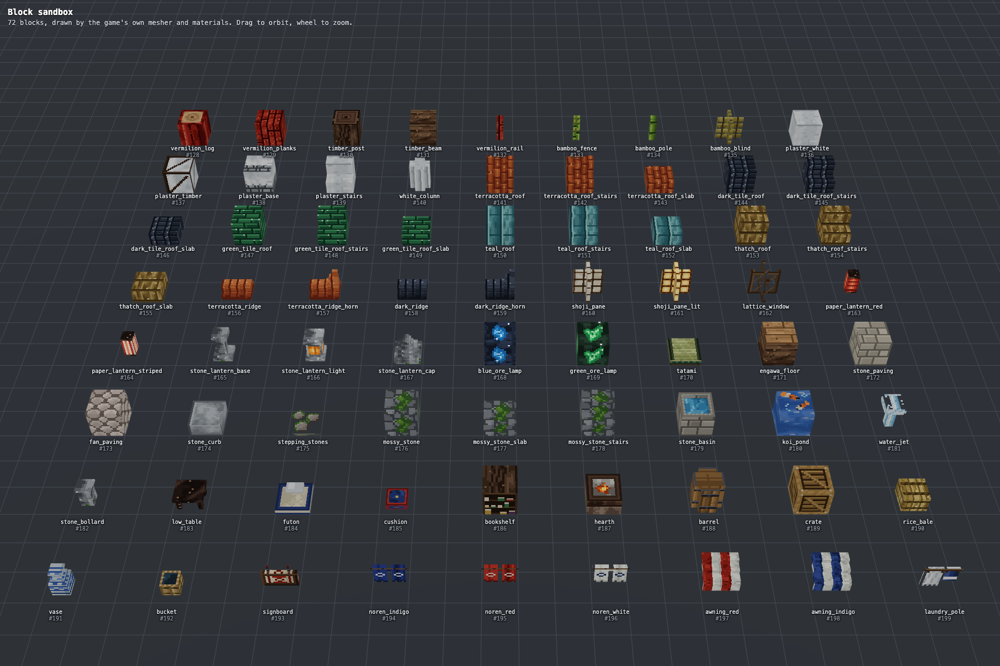
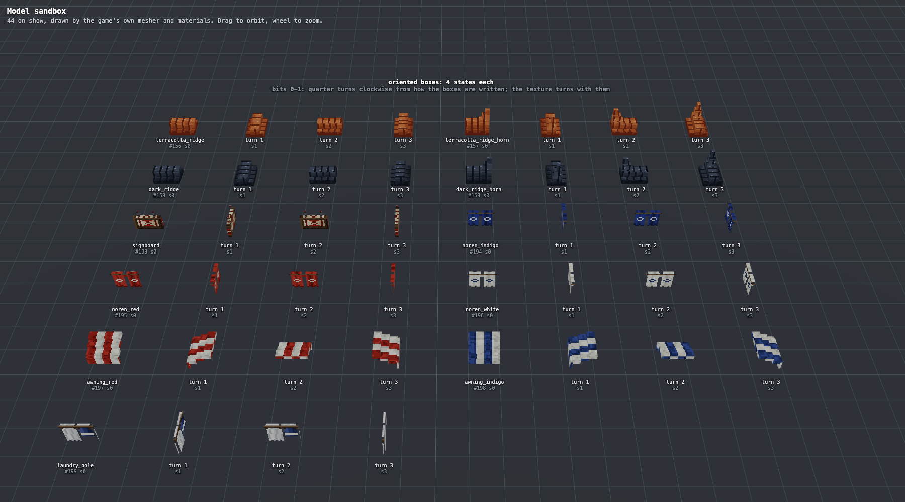
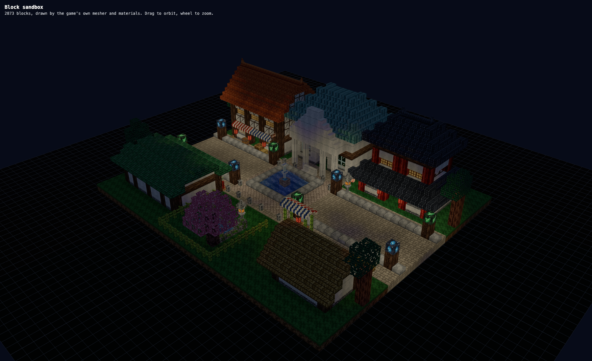
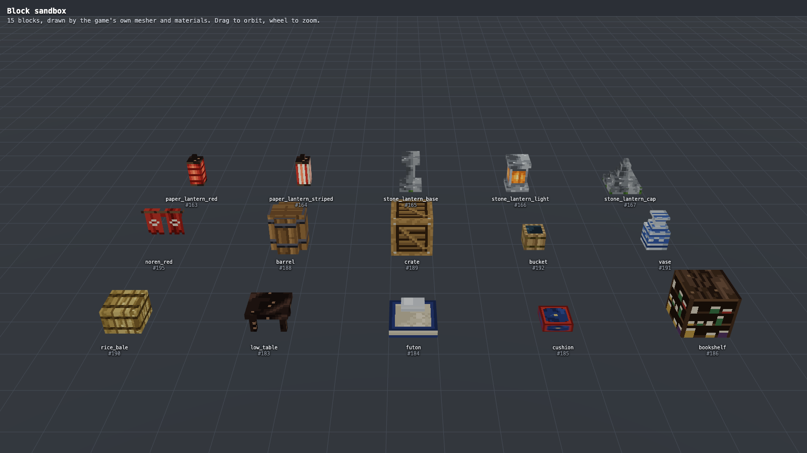
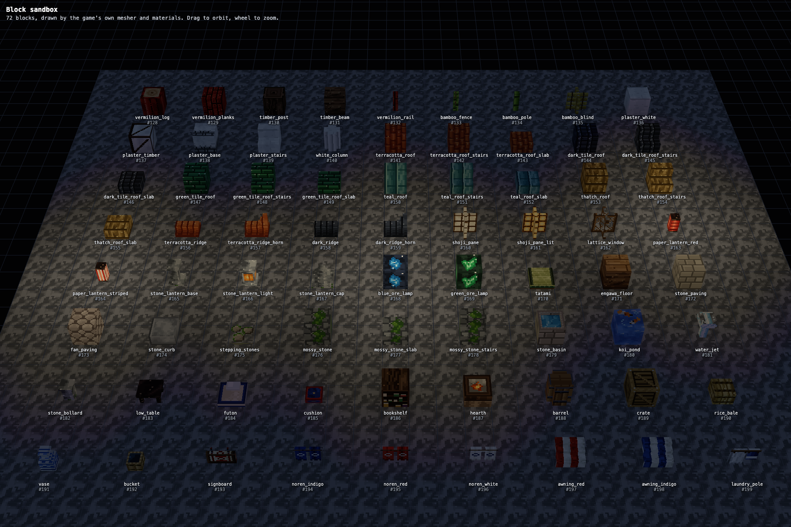
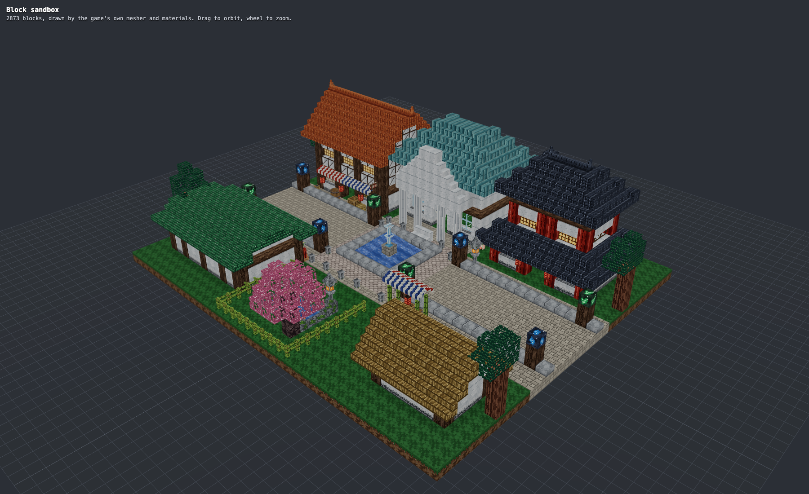
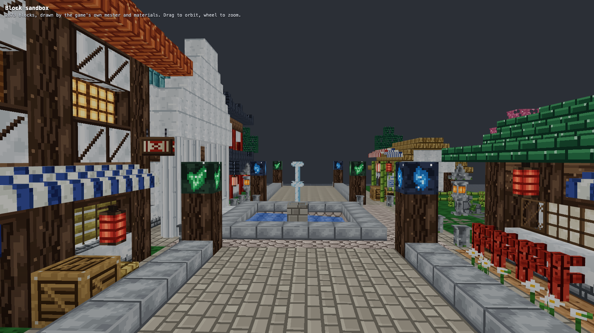
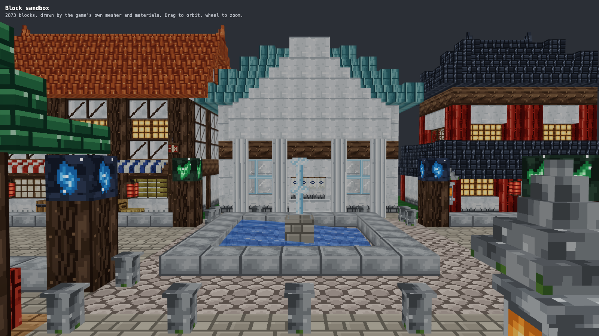
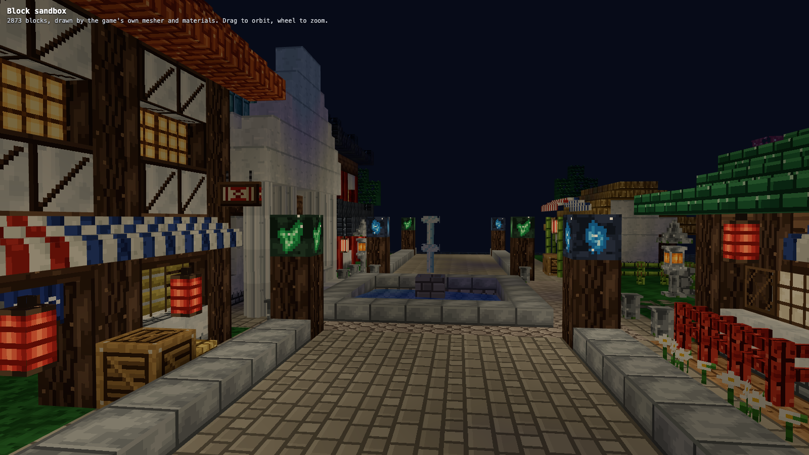

# Tempest blocks

Step 7.1a of the Tempest city (Phase 7) is the set of blocks the town is built from: 72 blocks at ids 128 to 199, drawn with 63 new generated tiles and shaped by the existing box models plus one new one, `OrientedBoxModel`. This page is the table of what each block is and what it does to light, how the shapes and tiles are made, and how to look at them. It is written for the next steps (building kits, landmarks, the town planner), which assemble these blocks and own ids 200 to 255.

`content/blocksTempest.ts` registers the set (`registerTempestBlocks`, called from `createDefaultRegistry` after the nature and shaped blocks, `TempestBlock` has the ids), and the tiles are in `content/textures/recipes/tempest*.ts`. **Ids are stable: never renumber one.** `tests/textures/tempest.test.ts` pins thirty-four of them by name.



## The look, and where it comes from

The owner's pictures in `reference/tempest/` (not in the repository, they are other people's artwork; `NOTES.md` there is ours, and says what to take from each) set the palette and the shapes. The set follows them where the first brief did not:

- **Terracotta is the main roof.** From above the town is one warm orange tile mass, so `terracotta_roof` (a half-round barrel tile, orange to red-brown, tile joints half a tile apart) is the ordinary roof and has a ridge cap with horned ends. **Deep blue slate is not in the set.** The dark Japanese tile is charcoal (`#181c25` to `#4d586c`), a heavy ridged kawara used as an accent, with its own ridge and horn. A test fails if any roof tile reads as blue slate.
- **The other roofs of the pictures:** green glazed tile (flat glazed tiles in courses, the inns and the bath), thatch (huts and stalls), and the **teal civic roof**: standing-seam sheets with no tile ribbing at all, which is what sets the white hall apart from the houses round it.
- **Dark timber against white plaster:** a post, a beam, plaster with a timber frame and brace, plaster on a stone footing, a fluted white column. Vermilion lacquer is for columns, planks and rails.
- **Paper and light:** shoji screens (plain, and lit warm from inside), a lattice screen, red and red-and-white paper lanterns (the main night light of the pictures), a stone lantern built from three blocks, blue and green magic ore.
- **Street and garden:** stone paving, **fan paving** (the overlapping scales of the main square), curbs, stepping stones, mossy stone with stairs and slab, a stone basin with a water jet for the fountain, koi on a pond, bollards.
- **Lived in:** noren curtains in indigo, red and white, striped awnings, a hanging signboard, laundry on a pole, barrels, a crate, a rice bale, a vase, a pail, a low table, a futon, a cushion, a bookshelf, a hearth with embers, tatami and an engawa floor, bamboo (fence, pole, blind).

## The blocks

`solid` is whether the player bumps into it; `opaque` whether it hides the faces it covers and stops light as a whole cube (see [light.md](light.md)). `emits` is block light, `dims` is `lightDim`. Tiles are listed top / bottom / side, or as one name when all faces match. "Model" is `modelKind`: `box` is a `BoxModel`, `oriented` an `OrientedBoxModel`.

| Id | Block | Model | Tiles | Solid | Opaque | Light |
| ---: | --- | --- | --- | :---: | :---: | --- |
| 128 | `vermilion_log` | cube | `vermilion_log_top` ends, `vermilion_log_side` sides | yes | yes |  |
| 129 | `vermilion_planks` | cube | `vermilion_planks` | yes | yes |  |
| 130 | `timber_post` | cube | `timber_end` ends, `timber_post_side` sides | yes | yes |  |
| 131 | `timber_beam` | cube | `timber_beam` | yes | yes |  |
| 132 | `vermilion_rail` | fence | `vermilion_planks` | yes | no |  |
| 133 | `bamboo_fence` | fence | `bamboo_fence` | yes | no |  |
| 134 | `bamboo_pole` | box | `bamboo_pole` | yes | no |  |
| 135 | `bamboo_blind` | pane | `bamboo_blind` | yes | no | dims 2 |
| 136 | `plaster_white` | cube | `plaster_white` | yes | yes |  |
| 137 | `plaster_timber` | cube | `plaster_timber` | yes | yes |  |
| 138 | `plaster_base` | cube | `plaster_base` | yes | yes |  |
| 139 | `plaster_stairs` | stairs | `plaster_white` | yes | yes |  |
| 140 | `white_column` | box | `plaster_white` / `column_white` / `column_white` | yes | no |  |
| 141 | `terracotta_roof` | cube | `terracotta_roof` | yes | yes |  |
| 142 | `terracotta_roof_stairs` | stairs | `terracotta_roof` | yes | yes |  |
| 143 | `terracotta_roof_slab` | slab | `terracotta_roof` | yes | yes |  |
| 144 | `dark_tile_roof` | cube | `dark_tile_roof` | yes | yes |  |
| 145 | `dark_tile_roof_stairs` | stairs | `dark_tile_roof` | yes | yes |  |
| 146 | `dark_tile_roof_slab` | slab | `dark_tile_roof` | yes | yes |  |
| 147 | `green_tile_roof` | cube | `green_tile_roof` | yes | yes |  |
| 148 | `green_tile_roof_stairs` | stairs | `green_tile_roof` | yes | yes |  |
| 149 | `green_tile_roof_slab` | slab | `green_tile_roof` | yes | yes |  |
| 150 | `teal_roof` | cube | `teal_roof` | yes | yes |  |
| 151 | `teal_roof_stairs` | stairs | `teal_roof` | yes | yes |  |
| 152 | `teal_roof_slab` | slab | `teal_roof` | yes | yes |  |
| 153 | `thatch_roof` | cube | `thatch_roof` | yes | yes |  |
| 154 | `thatch_roof_stairs` | stairs | `thatch_roof` | yes | yes |  |
| 155 | `thatch_roof_slab` | slab | `thatch_roof` | yes | yes |  |
| 156 | `terracotta_ridge` | oriented | `terracotta_ridge` | yes | no |  |
| 157 | `terracotta_ridge_horn` | oriented | `terracotta_ridge` | yes | no |  |
| 158 | `dark_ridge` | oriented | `dark_ridge` | yes | no |  |
| 159 | `dark_ridge_horn` | oriented | `dark_ridge` | yes | no |  |
| 160 | `shoji_pane` | pane | `shoji` | yes | no | dims 2 |
| 161 | `shoji_pane_lit` | pane | `shoji_lit` | yes | no | emits 8, dims 2 |
| 162 | `lattice_window` | pane | `lattice_window` | yes | no |  |
| 163 | `paper_lantern_red` | box | `black_lacquer` / `paper_lantern_red` / `paper_lantern_red` | no | no | emits 14 |
| 164 | `paper_lantern_striped` | box | `black_lacquer` / `paper_lantern_striped` / `paper_lantern_striped` | no | no | emits 14 |
| 165 | `stone_lantern_base` | box | `lantern_stone` | yes | no |  |
| 166 | `stone_lantern_light` | box | `lantern_stone` / `stone_lantern_light` / `stone_lantern_light` | yes | no | emits 12 |
| 167 | `stone_lantern_cap` | box | `lantern_stone` | yes | no |  |
| 168 | `blue_ore_lamp` | cube | `blue_ore_lamp` | yes | yes | emits 15 |
| 169 | `green_ore_lamp` | cube | `green_ore_lamp` | yes | yes | emits 13 |
| 170 | `tatami` | box | `tatami_top` / `tatami_side` / `tatami_side` | yes | yes |  |
| 171 | `engawa_floor` | cube | `engawa_floor` / `timber_beam` / `timber_beam` | yes | yes |  |
| 172 | `stone_paving` | cube | `stone_paving` | yes | yes |  |
| 173 | `fan_paving` | cube | `fan_paving` | yes | yes |  |
| 174 | `stone_curb` | slab | `curb_top` / `curb_side` / `curb_side` | yes | yes |  |
| 175 | `stepping_stones` | plate | `stepping_stones` | no | no |  |
| 176 | `mossy_stone` | cube | `mossy_stone` | yes | yes |  |
| 177 | `mossy_stone_slab` | slab | `mossy_stone` | yes | yes |  |
| 178 | `mossy_stone_stairs` | stairs | `mossy_stone` | yes | yes |  |
| 179 | `stone_basin` | box | `basin_top` / `ashlar` / `ashlar` | yes | no |  |
| 180 | `koi_pond` | plate | `koi` | no | no |  |
| 181 | `water_jet` | box | `water_jet` | no | no |  |
| 182 | `stone_bollard` | box | `lantern_stone` | yes | no |  |
| 183 | `low_table` | box | `black_lacquer` | yes | no |  |
| 184 | `futon` | box | `futon_top` / `futon_side` / `futon_side` | yes | no |  |
| 185 | `cushion` | box | `cushion` | yes | no |  |
| 186 | `bookshelf` | cube | `timber_post_side` / `bookshelf` / `bookshelf` | yes | yes |  |
| 187 | `hearth` | box | `hearth_top` / `hearth_side` / `hearth_side` | yes | no | emits 8 |
| 188 | `barrel` | box | `barrel_top` / `barrel_side` / `barrel_side` | yes | no |  |
| 189 | `crate` | cube | `crate` | yes | yes |  |
| 190 | `rice_bale` | box | `rice_bale` | yes | no |  |
| 191 | `vase` | box | `vase` | yes | no |  |
| 192 | `bucket` | box | `bucket_top` / `bucket_side` / `bucket_side` | yes | no |  |
| 193 | `signboard` | oriented | `signboard` | no | no |  |
| 194 | `noren_indigo` | oriented | `noren_indigo` | no | no |  |
| 195 | `noren_red` | oriented | `noren_red` | no | no |  |
| 196 | `noren_white` | oriented | `noren_white` | no | no |  |
| 197 | `awning_red` | oriented | `awning_red` | yes | no | dims 3 |
| 198 | `awning_indigo` | oriented | `awning_indigo` | yes | no | dims 3 |
| 199 | `laundry_pole` | oriented | `laundry` | no | no |  |

Stairs, slabs and the shaft of a column all wear the tile of the cube they belong to, so a roof is one material whether it is a block, a stair or a slab. Every roof comes as a full block, stairs and a slab; the plaster has stairs (for pediments and cornices), the moss stone has stairs and a slab, the curb is a slab.

## Models

Everything that is not a cube is built from boxes written in **pixels of the 16 by 16 tile** (`px(...)` in `blocksTempest.ts`), most of them in the `cell` mapping, which lays the tile over the whole cell and shows the part each box covers. So a tile is a picture of the object where it stands: the paper lantern's tile is a lantern with its cord on rows 0 and 1, its caps on rows 2 and 13 and its body on columns 5 to 10, and the box that is the body shows exactly that. The tile comments say which rows and columns the boxes of their block use.

| Block | Boxes |
| --- | --- |
| `paper_lantern_*` | a body 6 wide and 12 tall under a thin cord (a second box) |
| `stone_lantern_*` | three blocks to stack: a foot, post and seat; a foot, a firebox with a window on every side (the middle one emits) and a plate; a wide eave, two roofs and a jewel |
| `white_column`, `barrel` | an eight-sided shaft from three non-overlapping boxes (a wide middle band and a narrower cap on each side), 12 and 14 wide |
| `stone_basin` | a floor, a rim two pixels thick, and a plate of water set two pixels under the rim: the basin top tile is drawn as rim and water, so the plate wears the water |
| `tatami` | a mat four sixteenths thick, covering the cell (a floor, its base hides what is under it) |
| `water_jet` | a column four wide and a spray ten wide on top |
| `koi_pond` | a `PlateModel` just over a cube of water (`holdsWater`), like the lily pad |
| `low_table`, `vase`, `futon`, `bucket`, `hearth`, `bollard`, `cushion`, `rice_bale` | small boxes |

### OrientedBoxModel

`engine/models/OrientedBoxModel.ts` is the only new model class, for things that stand four ways: a ridge cap along either axis with its horn at either end, an awning that falls towards any street, a curtain across a door on either axis, a sign that hangs along or across a wall. It takes boxes written in one orientation and turns them clockwise (seen from above) around the middle of the cell: **state bits 0 and 1 are the number of quarter turns**, 0 to 3, and the other bits are unused. The texture turns with the geometry (`compileBoxes` takes `uvTurns` and looks the texture up where each face was before the turn), so a stripe keeps running along its awning and the horn of a ridge cap stays on the end it was drawn on. Collision, coverage and culling turn with the boxes. `?sandbox=models&view=oriented` shows each oriented block in its four states:



As written: a ridge runs east to west with its horn at the **east** end (turn 1 puts the horn south, 2 west, 3 north); an awning has its high edge at the **north** wall and falls south (turn 1 puts the wall east, 2 south, 3 west); curtains, signs and washing lines are planes along x (turn 1 along z). `rotateBox` moved from `ShapeModel.ts` to `shape.ts` so `compileBoxes` could use it; it is still exported from both. `tests/models/oriented.test.ts` covers the turning, the texture, the culling and the unused bits.

## Light

Blocks that give off light, and blocks that soak it:

| Block | `emits` | Note |
| --- | ---: | --- |
| `blue_ore_lamp` | 15 | a lump of rock cracked open on blue crystal |
| `paper_lantern_red`, `paper_lantern_striped` | 14 | the main night light of the pictures |
| `green_ore_lamp` | 13 | |
| `stone_lantern_light` | 12 | only the middle block of the stack |
| `shoji_pane_lit` | 8 | a lamp behind the paper: the interiors that glow in the pictures |
| `hearth` | 8 | embers |

Paper and cloth let light through at a cost (`lightDim`): the shoji screens and the bamboo blind 2, the awnings 3 (shade under them). Nothing else in the set dims. A lit pane is a separate block from a plain one so a builder chooses which windows glow.

**Block light has one colour.** The shader tints all block light warm (`vec3(1, 0.84, 0.6)`, see [light.md](light.md#the-shader)), so the blue and green ore lamps shine blue and green on their own faces (their `emits` makes the face bright) but light the street round them in the same warm light as a lantern. Coloured light would need a second light channel, which the light engine does not have; it is not planned.



## The smoke vent

Id 200, after the 72 above (the 128 to 199 range stays exactly the set the tests pin), is the one block of the living-world effects ([effects.md](effects.md)): `smoke_vent`, a clay chimney pot (a body 8 wide and 10 tall under a lip 10 wide) in the barrel tile of the terracotta roofs with a sooty `black_lacquer` mouth, solid, not opaque, no light. It stands on the slab cap of every chimney the kits build (`chimneyStack` in `worldgen/kits/tempest/parts.ts`, the workshop's own chimney and the garden house's), and smoke rises from its mouth: its `BlockDef.fx` is `BlockFx.SMOKE`. Never renumber it.

The effects also give some of the blocks above flags that change nothing about them in the world: the paper lanterns (0.5), the stone lantern's lit block (0.45) and the lit shoji screen (0.3) flicker, the hearth (1) flickers and gives off embers, lanterns and the ore lamps get a halo at night, and the koi pond is a place fireflies hide. Which blocks have which flags is one table in `content/blocksTempest.ts` (`fx`, `flicker`).

## Sandbox pages

`?sandbox=blocks&view=tempest` lists the whole set in id order, nine to a row (`&cols=` changes that). Three options are new for every sandbox view:

| URL | Shows |
| --- | --- |
| `?sandbox=blocks&view=tempest` | the 72 blocks, the picture at the top of this page |
| `?sandbox=blocks&night=1` (or `&sky=night`) | any view with the block light baked in (the same light engine as the world, chunk by chunk) under the game's night sky values, on a floor of stone so the light has something to fall on |
| `?sandbox=blocks&fov=60` | the camera's field of view in degrees (20 to 110); the default camera is framed for 30, a wide one is for eye-level shots with `&cam=px,py,pz,tx,ty,tz` |
| `?sandbox=blocks&view=street` | a street built from the set (below) |
| `?sandbox=models&view=oriented` | the oriented blocks in their four turns |




### The street

`components/sandbox/tempestScene.ts` builds a street 38 by 32 blocks from nothing but registry blocks, so the set can be judged as a kit and not only as single cubes. It is a fixed test of the blocks meeting each other (`tests/tempestScene.test.ts`), not the town: it has a half-timber shop under a terracotta gable with horned ends, a two-tier house under dark horned tile and vermilion posts, a white hall with fluted columns, a pediment and a teal hip roof, an inn under green glaze with an engawa and a red-white awning, a market stall, a thatched hut with washing, a garden with a koi pond, a stone lantern, a sakura tree and a bamboo fence, and a plaza of fan paving with a fountain, a bollard line and lamp posts of glowing ore. It stands at the middle of the Tempest zone so the grass wears Tempest's colour.

Roof recipes it uses, for the building kits to take over (`gableRoof` and `hipRoof` in that file):

- **Steep gable:** stairs climb one block per block from both eaves (south slope facing north, north slope facing south), an odd span so a cube makes the crest, a ridge cap on the crest with horns at both ends (state 0 east, state 2 west), and the gable triangles filled with wall.
- **Gentle gable** (a half block per block): slab, stair, slab, stair from each eave; the span must be a multiple of four plus one. The green inn uses it.
- **Hip:** rings of stairs facing inwards, corners of full blocks, a ridge on the last row. The teal hall and the top of the pagoda.
- **Skirt roof** round a ground floor: two rings of stairs, the second storey standing inside the inner ring.






The screenshots come from:

```bash
node bench/run.mjs --width 1800 --height 1200 --url "http://localhost:3105/?sandbox=blocks&view=tempest&cam=12.5,29,41,12.5,0,11.5" --shot docs/screens/p7/tempest-blocks.png
node bench/run.mjs --width 1800 --height 1100 --url "http://localhost:3105/?sandbox=blocks&view=street&night=1&fov=38&cam=58,36,56,19,2,15" --shot docs/screens/p7/tempest-night.png
node bench/run.mjs --width 1600 --height 900 --url "http://localhost:3105/?sandbox=blocks&view=street&fov=60&cam=3,2.7,16,30,3.5,15" --shot docs/screens/p7/tempest-street-eye.png
node bench/run.mjs --width 1800 --height 1000 --url "http://localhost:3105/?sandbox=models&view=oriented&fov=36&cam=11.5,24,34,11.5,0,10.5" --shot docs/screens/p7/tempest-models-oriented.png
```

## Tiles

63 tiles, 141 in the catalog, 144 layers in the texture array (the 256 every WebGL2 device guarantees is far off). The same art rules as [textures.md](textures.md#art-rules): 16 by 16, 3 to 12 colours, clustered noise or drawn pixel by pixel, light from the upper left, seeded and deterministic, tileable where the tile says so. The tests of `catalog.test.ts` run on all of them (size, determinism, palette, alpha, seams, and that no two tiles are within 12 per byte of each other); `tests/textures/tempest.test.ts` adds what they look like.

Most of these tiles are **drawn** (`DrawnTile` in `recipes/tempestKit.ts`: a name, two options and a function that paints a `Canvas`) rather than grown from noise, because a lantern, a curtain or a vase is a picture. The ones laid over a cell for a model to cut say which rows and columns matter.

| Group | Tiles |
| --- | --- |
| Timber and bamboo | `vermilion_log_side`, `vermilion_log_top`, `vermilion_planks`, `timber_post_side`, `timber_end`, `timber_beam`, `bamboo_fence`, `bamboo_pole`, `bamboo_blind` |
| Floors | `tatami_top`, `tatami_side`, `engawa_floor` |
| Plaster and roofs | `plaster_white`, `plaster_timber`, `plaster_base`, `column_white`, `terracotta_roof`, `dark_tile_roof`, `green_tile_roof`, `teal_roof`, `thatch_roof`, `terracotta_ridge`, `dark_ridge` |
| Stone and water | `stone_paving`, `fan_paving`, `curb_top`, `curb_side`, `stepping_stones`, `mossy_stone`, `ashlar`, `koi`, `basin_top`, `water_jet` |
| Light | `shoji`, `shoji_lit`, `lattice_window`, `black_lacquer`, `paper_lantern_red`, `paper_lantern_striped`, `stone_lantern_light`, `lantern_stone`, `blue_ore_lamp`, `green_ore_lamp` |
| Rooms and street | `futon_top`, `futon_side`, `cushion`, `bookshelf`, `hearth_top`, `hearth_side`, `barrel_side`, `barrel_top`, `crate`, `rice_bale`, `vase`, `signboard`, `bucket_side`, `bucket_top` |
| Cloth | `noren_indigo`, `noren_red`, `noren_white`, `awning_red`, `awning_indigo`, `laundry` |

Choices worth knowing:

- **The roofs read differently on purpose.** Terracotta is a barrel tile four pixels to a rib, the dark tile has a bold ridge every eight pixels, green is flat glazed tiles in courses and teal is standing seams, so a roof is recognised from its pattern and not only its colour, also in dim light.
- **No tile is tinted.** The biome colour must never be multiplied into a roof or a lantern.
- **Cutouts (alpha 0 or 255) are used where the model leaves holes:** the lantern, noren, signboard, washing, panes with open lattice, the bamboo pole, stepping stones, the koi and the jet. A block that uses an opaque tile may be a cutout block; an opaque block never wears a cutout tile (tested).
- **Lit things are drawn bright:** the lit shoji, the lantern windows, ore and embers have pixels above 190 of 255 luminance (the plain red lantern reaches 168: it is red). The shader's glow does the rest.
- **The tatami edge and the curb side are drawn for the part of the cell their box shows** (the bottom four rows; the lit top edge on row 8), not as pictures of a whole block.

## What is not there yet

Looking at the street next to the pictures, honestly:

- **Eaves are curved by the builder, not by a block.** The pictures have upswept pagoda eaves; the set has the horned ridge ends but no curved eave tip. Step 7.1b builds the flare from the existing stairs and slabs (a lifted lip of top slabs, a flat run, then the climb, with corner tips: roof profiles in [tempest.md](tempest.md#roofs-profiles-as-data)); the corner tips are blocky, and a flared tile block would need ids and a model, which 128 to 199 no longer have (200 to 255 do).
- **The hall is a diorama.** Its pediment is a 45 degree step pyramid and its windows are glass panes. The landmark step builds the real Town Hall (a flatter pediment, arched windows, three gables).
- **Yurt domes, the aqueduct and the terraced glowing pools** of the pictures are not in the set. The domes want a round roof the box models cannot make; the pool and aqueduct are built from stone, slabs and water (the basin and `fan_paving` are there for the pools).
- **Scale of detail.** A tile is 16 pixels: the red lanterns read as lanterns up close and as red dots from a distance, which is what the pictures' lanterns do too.
- **Lanterns and lamp posts** give warm light only (above).

## Tests

`tests/textures/tempest.test.ts` (ids 128 to 199 once each and pinned, every block's faces and tiles, no unused tile, opaque and cutout rules, no tint, what each tile looks like: terracotta orange and the warmest roof, no blue slate, teal civic roof, plaster white and timber dark, lit things bright, stripes in the awnings; the light table; models inside their cells, the horn and awning turning the right way, the lantern stack, the basin and tatami), `tests/tempestScene.test.ts` (the street builds the same every time from real blocks, its roofs climb the right way, the gables are closed, the fountain, the baked night light, the sandbox options), `tests/models/oriented.test.ts` and the extended `tests/sandboxModels.test.ts`.
