# Tempest landmarks and interiors

Step 7.2c of Phase 7 draws the places of the town that have a name: the civic compound and Town Hall, the arena, the plaza, the gates, the cave, the cairn, the pastures, the stalls, the bridge and the aqueduct, three free set pieces (bell tower, market hall, bath house) and the **interior furnisher** the house kits call to fill rooms. Everything is built with the builder of [tempest.md](tempest.md), from the blocks of [tempest-blocks.md](tempest-blocks.md), and is looked at in the viewer `?sandbox=landmarks`.

| What | Where |
| --- | --- |
| The landmark spec, the registry, building and placing | `worldgen/tempest/landmarks/LandmarkSpec.ts`, `index.ts` |
| Shared pieces (rings, arches, lamps, trees, walls) | `worldgen/tempest/landmarks/parts.ts` |
| The compound and the Town Hall | `CivicCompound.ts`, `TownHall.ts` |
| The arena, its training yard and barracks | `Arena.ts`, `GuardHutAndStalls.ts` (the guard hut) |
| The Central Square | `CentralSquare.ts` |
| Gates, west stalls and stables | `Gatehouse.ts`, `GuardHutAndStalls.ts` |
| The cave portal, the glowing pools, the cairn, the lumber clearing, the pastures | `Wilds.ts` |
| The east bridge and the aqueduct | `Waterworks.ts` |
| Bell tower, market hall, bath house | `SetPieces.ts` |
| The interior furnisher | `worldgen/tempest/interiors/InteriorFurnisher.ts`, `boxRoom.ts` |
| The viewer | `components/sandbox/LandmarkSandbox.tsx`, `landmarksLayout.ts` |
| Tests | `tests/landmarks/`, `tests/landmarkSandbox.test.ts` |

Like the rest of `worldgen/`, none of it imports Three.js, React or the DOM (`tests/worldgen/structures-purity.test.ts` reads every file).

## A landmark is a spec

```ts
interface LandmarkSpec {
  id: string;                    // the layout landmark's id where there is one
  name: string;
  covers: readonly string[];     // the layout landmarks this blueprint draws (the compound covers the Town Hall, forecourt and lodge)
  facing: Facing;                // the side its front looks, as the layout says
  footprint: Rect;               // the layout's rectangle in world cells: the blueprint must stay inside it
  frame: 'front-south' | 'world';
  optional?: boolean;            // the plan's optional set pieces
  free?: boolean;                // no place of its own: a planner stands it on a lot (bell tower, market hall, bath house)
  partOf?: string;               // drawn inside another (the Town Hall is inside the compound): a zone places only the container
  river?: { x0; x1; bed; surface };  // the channel the piece assumes under it (the bridge)
  build(style: StylePack, rng: Rng): Blueprint;
}
```

Most landmarks are written in the **kit frame** (front towards south, the footprint's corner at 0, 0, y = 0 the ground row) and turned to their facing by the same `Lot` the kits use, so a gate is written once whichever way its road runs. The long ones with no front (the bridge, the aqueduct) are in the **world frame** and never turned. `buildLandmark(spec, style?, seed?)` draws one, with the generator forked from the landmark's id so that changing one never shifts the details of another; `placeLandmark(spec, groundY?)` builds and places it on the layout's rectangle; `placeOnLot(spec, lot)` stands a free set piece on a lot (and throws if the lot is too small); `createTempestLandmarks()` is the registry (`get(id)`, `covering(layoutId)`). The zone step of Phase 7 loops over `registry.specs`, skips `free` and `partOf` ones, and places the rest with `placeLandmark`.

All of them are deterministic: the same seed gives the same blueprint (`LANDMARK_SEED` by default, `&seed=` in the viewer), and a different seed changes the trees, flowers, rock and the choices of the stalls and gates.

## What is built

Sizes are blocks of the blueprint's footprint; times are the measured build time of the blueprint on the development machine (Apple M4, Node, warm), once, in a worker.

| Landmark | Footprint | Blocks | Build |
| --- | --- | ---: | ---: |
| `civic-compound` (walled yard, forecourt, gate and towers, gardens with koi ponds and sakura, lodge, **and the Town Hall in it**) | 49 by 51 | 10,945 | 4.3 ms |
| `town-hall` (alone, for the viewer) | 31 by 25 | 6,289 | 1.3 ms |
| `arena` (ring, tunnels, towers, training yard, barracks, apron) | 69 by 69 | 26,628 | 3.5 ms |
| `central-square` | 15 by 15 | 230 | 0.2 ms |
| `west-gate`, `north-gate` (big timber gatehouses) | 19 by 7 | 784 | 0.2 ms |
| `east-gatehouse`, `south-gatehouse` (modest) | 19 by 7 | 325 | 0.1 ms |
| `north-cave` (rock face with the sealed portal) | 19 by 19 | 4,762 | 0.6 ms |
| `cave-pools` (optional, four glowing terraces) | 33 by 33 | 3,635 | 0.8 ms |
| `south-cairn` (memorial on its hill) | 25 by 25 | 2,823 | 0.3 ms |
| `west-stalls-north`, `-south` (stables and market stalls) | 8 by 25 | 605 | 0.2 ms |
| `horse-pasture`, `paddock` | 69 by 69, 57 by 57 | 1,161, 988 | 0.9, 0.5 ms |
| `arena-guard-hut` | 6 by 6 | 135 | under 0.1 ms |
| `east-bridge` | 23 by 13 | 1,597 | 0.3 ms |
| `aqueduct` (optional) | 97 by 9 | 6,372 | 1.4 ms |
| `lumber-clearing` (optional) | 61 by 61 | 4,916 | 1.0 ms |
| `bell-tower`, `market-hall`, `bath-house` (free, optional) | 17 by 17, 31 by 17, 25 by 21 | 1,264, 1,403, 1,599 | 0.2, 0.2, 0.6 ms |

Every landmark in the layout has a spec (a test checks the list), and the whole town's landmarks together build in about 20 ms, so nothing here is a cost for the zone.

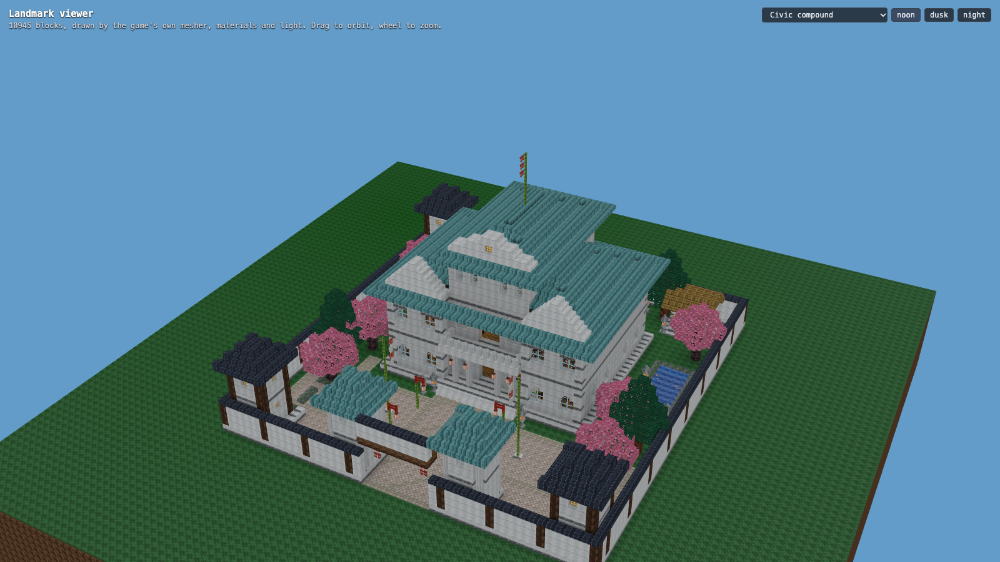
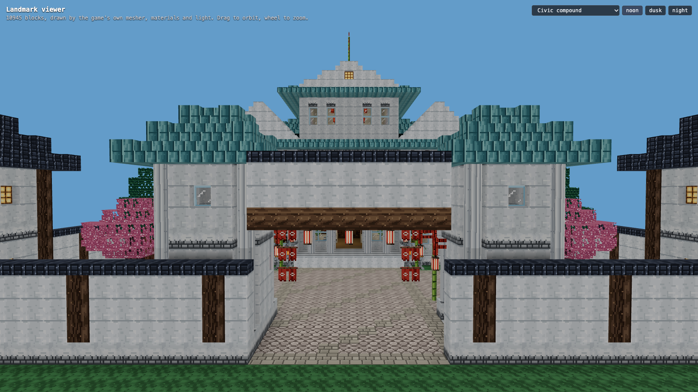
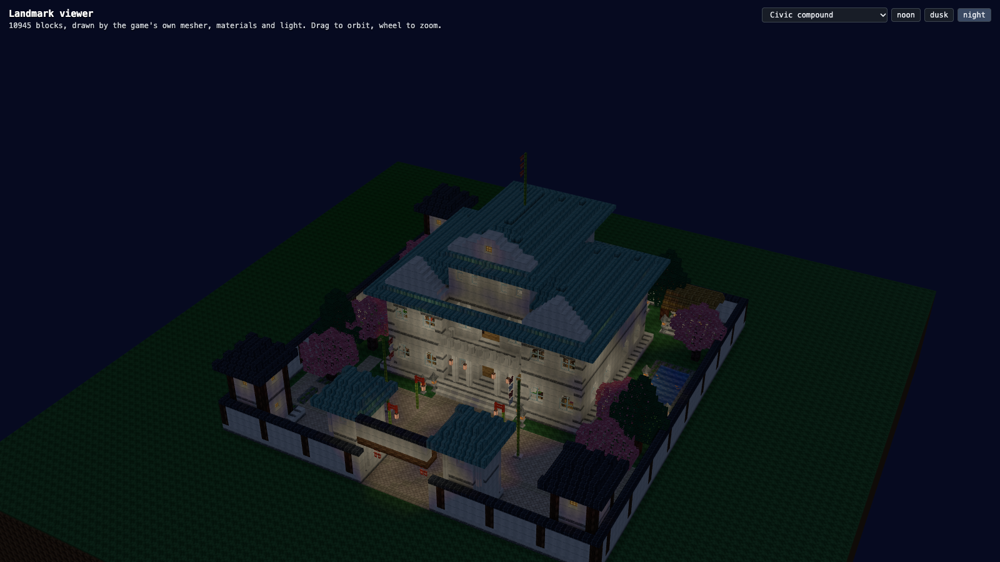

**The civic compound and the Town Hall** (`CivicCompound.ts`, `TownHall.ts`). A walled yard 49 by 51 at the head of the north-south avenue with its gate on the avenue's axis between two gate towers with banners and lanterns. Inside, a forecourt of fan paving with bands of plain stone and a line of bollards along the wall (Tempest-3's plaza), flagpoles with red and white banners, lamps along the avenue, steps up to the hall, gardens either side with koi ponds, stepping stones and built sakura and cedar, a long pond behind it with a bridge, corner towers in dark tile and the small lodge in the north east corner. The hall itself is the picture's white neoclassical building: a plinth, two wings that stand forward and a recessed centre, string courses and quoins, arched windows below and square ones with little pediments above, a portico of four columns with a balcony over it, a low teal hip roof, a taller centre block with a flat pediment of its own and a lit window in it, steps, stone lanterns and a flagpole. The bay shapes are real `StairModel` arches (upside-down stairs cut the corners of the openings), the pediments are stairs and cubes.

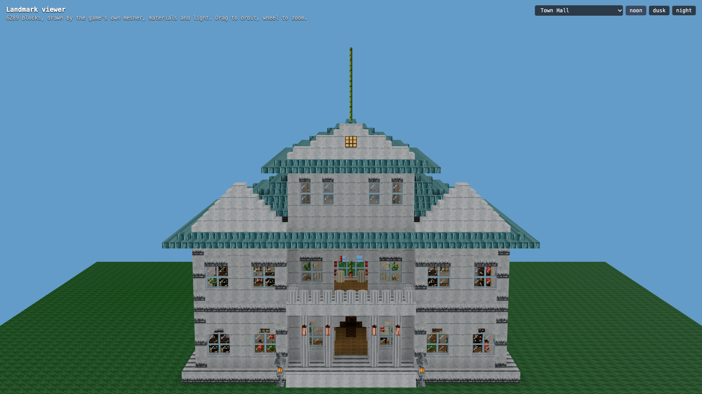


Inside (everything reached on foot, a test walks it with the game's own collision): a lobby behind the door; a **council hall** two storeys high with columns, a dais of vermilion planks against the far wall with a high seat, braziers and a window of red curtains, a long table with a chair at every place, a runner down the aisle and banners; a gallery over the lobby that looks into the hall through an opening; and in each wing a stair hall and rooms for the clerks on both floors, laid out by `partition`.

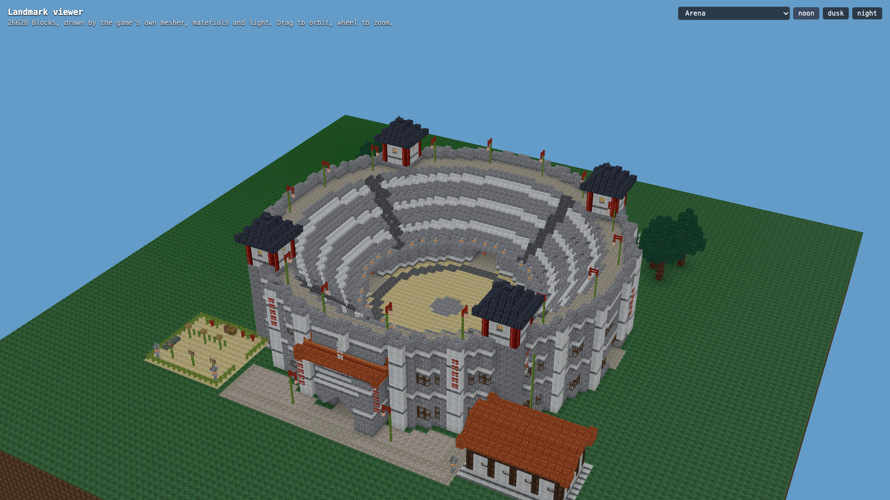
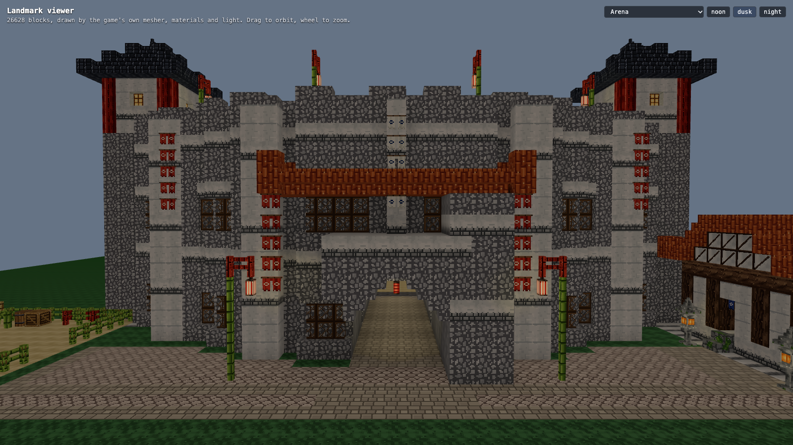
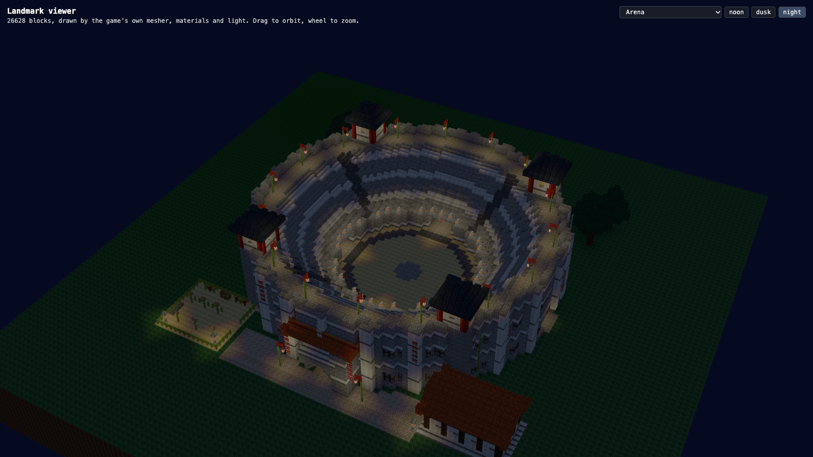

**The arena** (`Arena.ts`): a ring 57 across with a sand floor with a gravel ring and a stone disc, a podium wall, ten rows of seats that are really stair blocks facing the way they climb (white plaster every third row and dark aisles), an upper walkway under a parapet with merlons and the outer wall ringed by pilasters, blind arches and banners. Four tunnels run under the stands from the four sides, the south one with a porch of two piers, a tile roof and banners; two chambers off it (a guard post and an armoury) are furnished by the furnisher; four towers with dark tile roofs and lit screens stand at the diagonals. Beside it, in the corners of the footprint, are the training yard (a fenced yard of straw dummies, targets and weapon racks), a barracks and the paved apron with lamps. The guard hut (`arena-guard-hut`) is its own six by six landmark by the road.

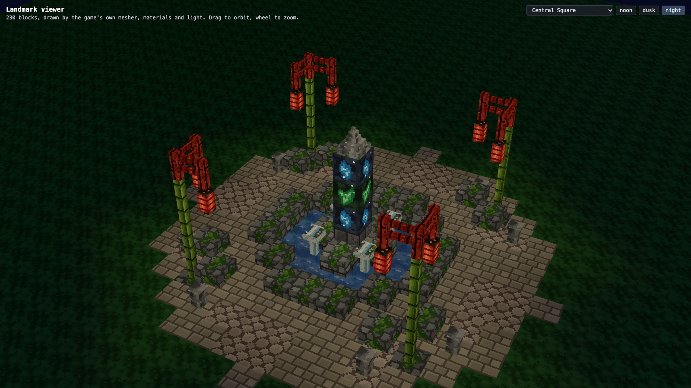

**The Central Square** (`CentralSquare.ts`): fan cobbles in sixteenths of a turn out from a round basin of water in mossy stone with jets, a pillar of blue and green magic ore on a pedestal that lights the square, a ring of bollards with a gap at each avenue, benches and four lamps with red lanterns. No statue.

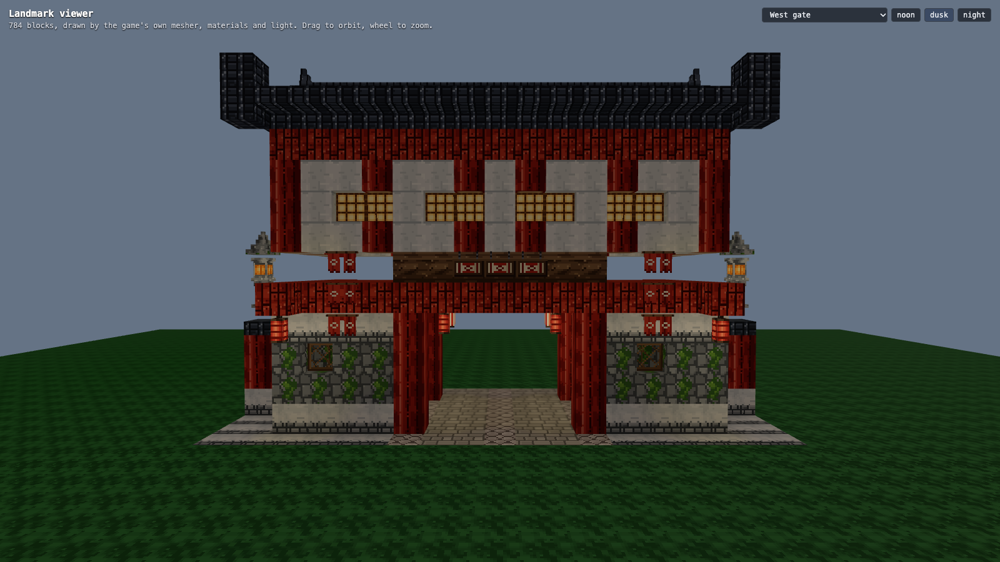
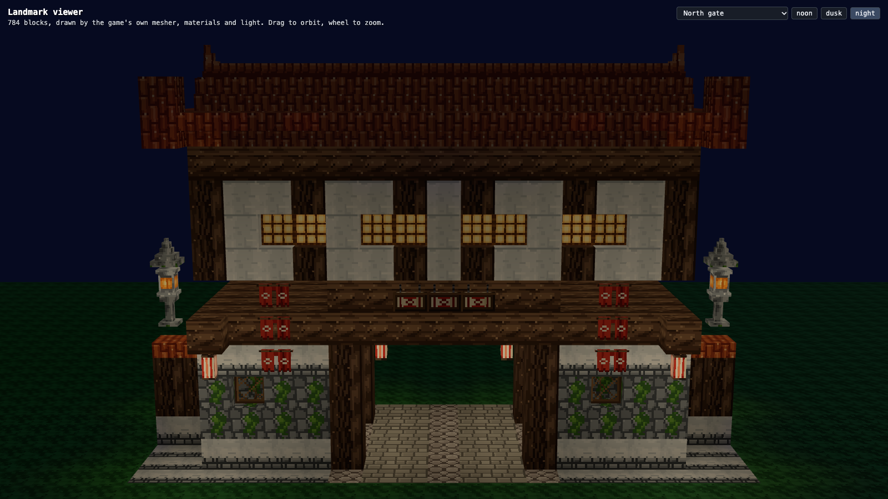

**Gates** (`Gatehouse.ts`): the big gates (west under dark tile with vermilion posts, north under terracotta over dark timber) are two stone piers with posts at a passage seven wide, a closed upper hall of plaster and timber with lit paper screens, a hip and gable roof with raised corners and horned ridge, banners, a signboard, hanging lanterns, and a wall run each side ending in a stone lantern. The east and south ones are four posts under a low flared gable with the same walls. Each is written once with the road running north to south and turned to the side it stands on by its facing in the layout; the passage opens exactly where the RoadNetwork's gate and the layout's road are.

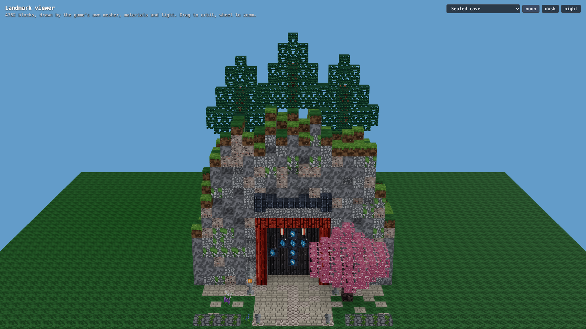
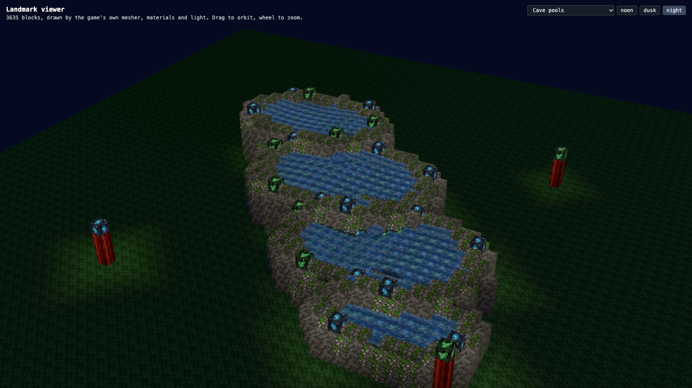
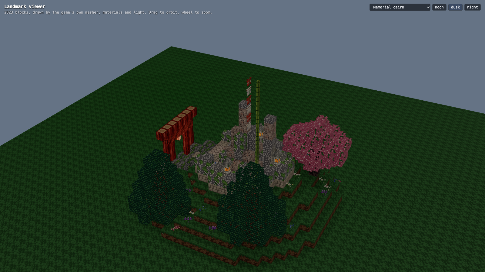

**The wilds** (`Wilds.ts`). The cave portal is a rock face built from below the ground to a grassy crown with cedars (the zone's ground there is the wilderness, not the town's flat one), with a doorway framed by lacquered posts under a small tile roof, and in it, two blocks back, the seal: black basalt with a rune of glowing blue ore; in front a forecourt, stepping stones, lanterns and a low mossy wall. The pools are four basins stepping down a slope, each with a floor of blue and green ore under the water, lamps of ore in the rim, water running over the lips and steps down the side. The cairn is a hill five blocks high with a paved terrace, a stepped pile of mossy, granite and cobble stone with a standing stone, a basin and vases, a mast with banners, a flight of steps between low walls from a lacquered gate at its foot. The lumber clearing is trodden earth with stumps, felled trunks, log stacks, a sawing frame, a shed, a cart and a firepit inside a ring of cedars and sakura. The pastures are a fence joined face to face round a field, an open shelter, hay, a trough, a worn track, ferns and flowers.

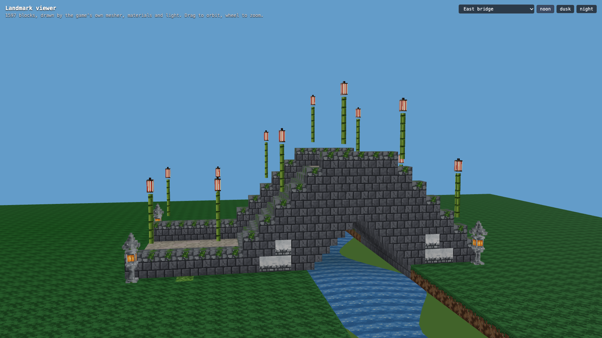
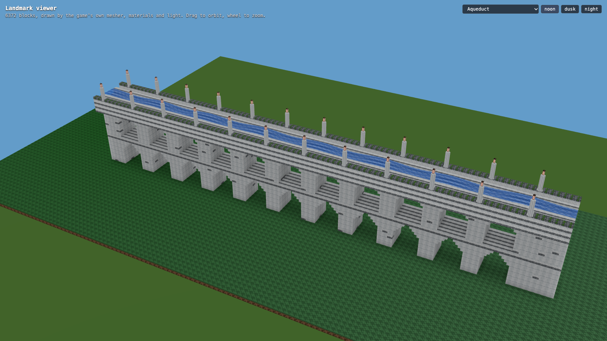

**Water crossings** (`Waterworks.ts`). The bridge is a hump of dressed mossy stone with a deck that steps up to a crown over a round arch seven wide, low walls with posts and lanterns every fourth cell, stone lanterns at the corners; the river under it is the zone's (the viewer digs a channel from the spec's `river`). The aqueduct (optional) is two tiers of round arches on piers three thick every eight cells in cream stone, a channel of running water between two walkways on top, and a post with a lantern over every pier.

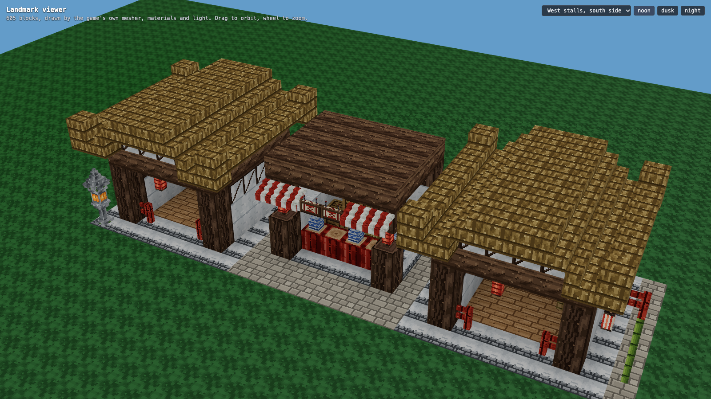

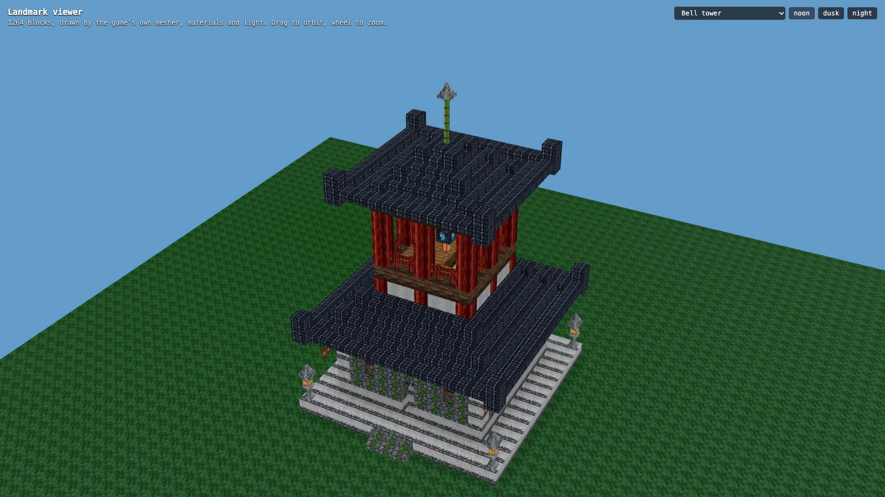
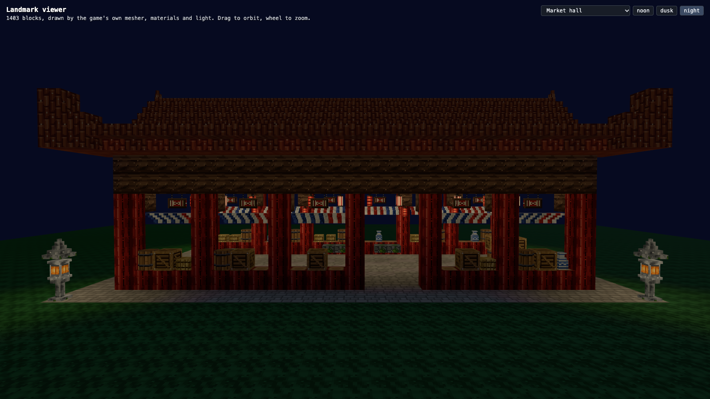
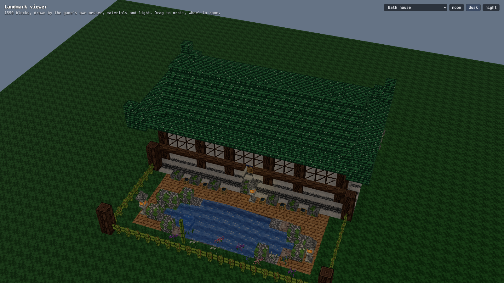

**Free set pieces** (`SetPieces.ts`). These have no plot in the layout; the planner chooses a lot and calls `placeOnLot`. The **bell tower** (17 by 17) is a stone plinth, a stone storey with a door, a skirt roof, a timber storey of lit screens, an open belfry with a bell of blue ore under a flared dark roof, two stairs inside. The **market hall** (31 by 17) is a long open hall on lacquered posts under one great terracotta roof with horned ends, counters with goods and red and indigo awnings along both sides, an aisle lit by a row of red and striped lanterns, a well. The **bath house** (25 by 21) is a half-timber hall under a green glazed roof with a veranda, a lobby and furnished rooms, and behind it a walled garden with a rock-edged hot spring, wash stools, a bamboo spout and lanterns.

## The interior furnisher

`worldgen/tempest/interiors`. The API the kits call:

```ts
furnish(blueprint, room, kind, rng, style?): FurnishResult
new InteriorFurnisher(blueprint, style?).partition(interior, floorY, entrance, kinds, rng, options): Array<{ room, kind }>
buildBoxRoom(builder, interior, { floorY, ceilingY, doors }): InteriorRoom     // a plain box to try a kind on
```

`room` is `{ rect, floorY, ceilingY?, doors, keepClear? }`: the free cells inside the walls, the floor row, the row of the lowest ceiling block (default `floorY + 4`), the cell just inside each door and the way it opens (`{ x, z, inward }`), and cells to leave bare (a stair, an opening in the floor above). The floor, the walls and the ceiling are the caller's; the furnisher adds what stands on the floor and hangs from the ceiling. `kind` is one of `living`, `bedroom`, `kitchen`, `shop`, `storage`, `study`, `inn`, `lobby`, `barracks`, `council`, `forge`, `weaving`. `FurnishResult` says what was placed (`items`, `lights`) and how much floor is left (`free`) and reachable from the first door (`reachable`).


| Kind | Contains |
| --- | --- |
| `living` | a low table with three cushions (a pair in a small room), a hearth, bookshelves by area, a vase, a planter or a bamboo pot, scrolls, a lamp table |
| `bedroom` | beds of two futons and a cushion, a lamp table, a bookshelf, a vase, a planter |
| `kitchen` | a double hearth, barrels and crates stacked, rice bales, buckets, a low shelf, a table set |
| `shop` | a counter on the floor with shelves of goods behind it and a lantern on it, goods rows, barrels, rice, signs |
| `storage` | stacks of crates and barrels by area, rice bales, a shelf |
| `study` | many bookshelves, a table set, a lamp table, scrolls |
| `inn` | table sets by area, a hearth, a counter, barrels, lamp tables |
| `lobby` | planters, a bench, scrolls, a vase, a lamp table |
| `barracks` | many beds, crates, a hearth, a table |
| `council` | a dais against the wall opposite the first door (vermilion planks with steps, a high seat, red curtains and banners behind, braziers at its front corners), a long table down the middle with a chair at every place, scrolls |
| `forge` | a three-wide furnace of cobblestone with a glowing fire-box, an anvil, charcoal, barrels, buckets, crates |
| `weaving` | looms of two posts, a beam and white warp hanging from it with a stool, rice, buckets, a table set |

**Rules** (all checked by `tests/landmarks/interiors.test.ts` on box rooms of five sizes and every kind):

- The cell just inside every door and the two cells behind it, and the cells beside them, are never built on; a walker from outside the first door reaches the cell inside every other door and more than 45 per cent of the floor. A piece that would cut the room is refused, one piece at a time.
- Furniture stands against walls (tall and plain things in corners, tables in the middle), with the cell in front of it free, and the furniture of a kit's own (a block already on the floor row) is kept, not built over.
- Lights hang at least three blocks above the floor, on a bamboo cord up to the ceiling when it is higher, and a room too low for one has none; a room is lit by lanterns placed at least 2.5 cells apart, the first near the middle.
- At least a third of the floor is clear in every kind and size.
- Same room, kind and generator, same furniture (a hash of the blueprint); a different seed differs in most kinds.
- `partition` splits a floor into rooms of at least `minSize` across with shoji partitions on timber posts, a doorway in each (never on a line through an entrance or a doorway already cut), assigns the kinds (the entrance room the first, the others by size) and furnishes them. `extraDoors` and `keepClear` let a building with stairs and several entrances (the Town Hall's wings) use it.

The Town Hall's wings, the arena's chambers and barracks, the bath house and the guard hut are furnished through this API, so the same code the kits will call is tested on a real building.

## The viewer

`?sandbox=landmarks&landmark=civic-compound` draws one landmark with its own builder on flat grass through the game's own mesher, texture array and baked block light, with the game's noon, dusk and night. A selector top right lists the landmarks and the sky.

| Option | Does |
| --- | --- |
| `landmark=arena` | which one (default `central-square`; the layout's ids, `bell-tower`, `market-hall`, `bath-house`, `interior-gallery`) |
| `sky=noon` / `dusk` / `night` | the sky preset |
| `view=iso` / `front` / `back` / `side` / `top` / `eye` | camera presets (`eye` stands in the street in front at eye height with a 62 degree view) |
| `az=30&el=20&zoom=1.4&fov=50` | swing, elevation, nearness and field of view of the preset |
| `cam=px,py,pz,tx,ty,tz` | an explicit camera in the blueprint's own coordinates |
| `maxY=14&minX=&maxX=&minZ=&maxZ=` | a cutaway: only the cells inside the limits, to see into rooms |
| `seed=7` | the generator's seed |

```bash
node bench/run.mjs --width 1600 --height 900 --url "http://localhost:3108/?sandbox=landmarks&landmark=town-hall&maxY=12&el=62&az=10&zoom=1.5&sky=night" --shot docs/screens/p7/landmarks-hall-council.png
```

`landmarksLayout.ts` is the pure half (options, stage, camera, cutaway) and is tested without a browser (`tests/landmarkSandbox.test.ts`); the page raises `window.__SHOT_READY__`.

## Tests

| File | Covers |
| --- | --- |
| `tests/landmarks/interiors.test.ts` | the furnisher on plain box rooms: deterministic, furnished, doors clear and reachable, furniture on walls, lights, nothing floating, a third of the floor free, `partition`, the council hall |
| `tests/landmarks/landmarks.test.ts` | every layout landmark has a spec; deterministic; **inside its footprint** in the blueprint frame and placed in the world; **no floating blocks**; real blocks in legal states; front doors look the landmark's way after placing; build time bounded; free pieces on a lot at all four facings and refused on a lot too small; the bridge crossed on foot over the crown and open underneath; the aqueduct carries water and has arches to pass under; **entrances reachable** (a walker from the street reaches each door and the cell inside); **interiors walkable** (from the first door every room marker is reachable, and the council hall's floor is stood on) |
| `tests/landmarkSandbox.test.ts` | the viewer's options, stage, cutaway, camera and light, meshed with the real mesher |
| `tests/landmarks/helpers.ts` | the walker: the game's own collision (`engine/collision.ts`) pushed one block at a time in four small steps with gravity between them, so a stair, a slab and a one block climb are walked as in play and a full block, a closed pane or a wall stops it |

Floating blocks are counted from the ground row up (a building stands on the surface row, y 0 and 1 count as the ground, as in the kit tests). Measured: the landmark tests run in about 2 seconds, the viewer tests in 2.5 s (the step's 34 tests in about 5 s).

## Deviations and what is still missing

Said plainly, side by side with the pictures (Tempest-1 to -8):

- **The neoclassical hall** is recognisable (white, teal hip roof, pediment gables, portico and balcony, arched windows) but its walls are the greyer plaster of the block set, its roof is a blockier stepped hip than the picture's smooth one, and the pediment is a stair-and-cube triangle with no moulding. The three gables of Tempest-3 are one centre pediment and two wing pediments.
- **The arena** has no statues or crowds and its tiers are grey where the picture is cream; the tunnels are walkable but plain.
- **Pagoda eaves**: the gates, bell tower, market hall and stalls use the builder's raised corners and horned ridge ends, which are still blocky (see the kits section of [tempest.md](tempest.md#whats-still-missing-side-by-side-with-the-pictures)). A flared tile block with its own model would need ids above 199.
- **The Central Square** is a 15 block roundabout with a column of ore, not the picture's wider fountain roundabout; the plan says radius 7, which is what the layout holds. The fan-cobble plaza of the picture is the forecourt of the compound.
- **The bridge** carries no road of its own: its ends meet the layout's `road-east`, which the zone paves. The river under it is the zone's; the viewer's is only a stand-in.
- **The aqueduct's** arches are stepped (a block narrower each row), not smooth curves, as every round shape here.
- **The forge and the weaving room** exist as room kinds with their furniture (see the gallery picture) but no landmark has one yet: the production kits (workshops, smithies, the weaving hall) are meant to call `furnish(..., 'forge')` and `'weaving'`.
- **The free set pieces** have no lot: the district planner decides where the market hall, bath house and bell tower stand (tourism quarter, according to the plan), and the zone step must call `placeOnLot`.
- **No NPCs, animals or horses**: the pastures and stables are empty.
