# The Tempest city: layout, structures and kits

Step 7.1b of Phase 7 builds the machinery the town is made with: a **layout** that says where every street, block and landmark of Tempest stands, a **structures** library for drawing buildings (blueprints, a builder with Japanese-fusion helpers, style packs, lots and kits), and a **viewer** where everyone judges a building (`?sandbox=kits`). The blocks the buildings are made of are in [tempest-blocks.md](tempest-blocks.md). This page is written for the steps that follow, which run in parallel and rely on it: the district planner and the house kits, the landmarks, the zone itself.

| What | Where |
| --- | --- |
| Blueprints, turning, mirroring, placing | `worldgen/structures/Blueprint.ts`, `orientation.ts` |
| Style packs | `worldgen/structures/StylePack.ts`, the Tempest pack in `worldgen/tempest/style.ts` |
| Roofs | `worldgen/structures/roofProfile.ts` (the profiles as data), `roofs.ts` (hip, gable, hip and gable, skirts, tips) |
| The builder | `worldgen/structures/BlueprintBuilder.ts` |
| Lots, kits, the registry | `Lot.ts`, `BuildingKit.ts`, `KitRegistry.ts`, the placeholder `BoxHouseKit.ts` |
| The Tempest layout | `worldgen/tempest/layout.ts` |
| The demonstration kits | `worldgen/tempest/kits/` (`TimberHouseKit`, `GateKit`, `LanternPostKit`, `RoofStudyKit`) |
| The kit viewer | `components/sandbox/KitSandbox.tsx` and `kitsLayout.ts` |

`worldgen/structures` and `worldgen/tempest` are pure data code like the rest of `worldgen/`: no Three.js, React or DOM (`tests/worldgen/structures-purity.test.ts`). The engine and `content/` never import them.

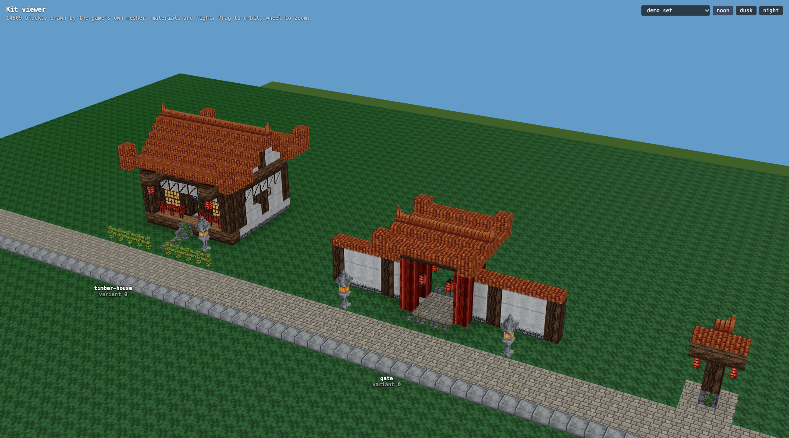
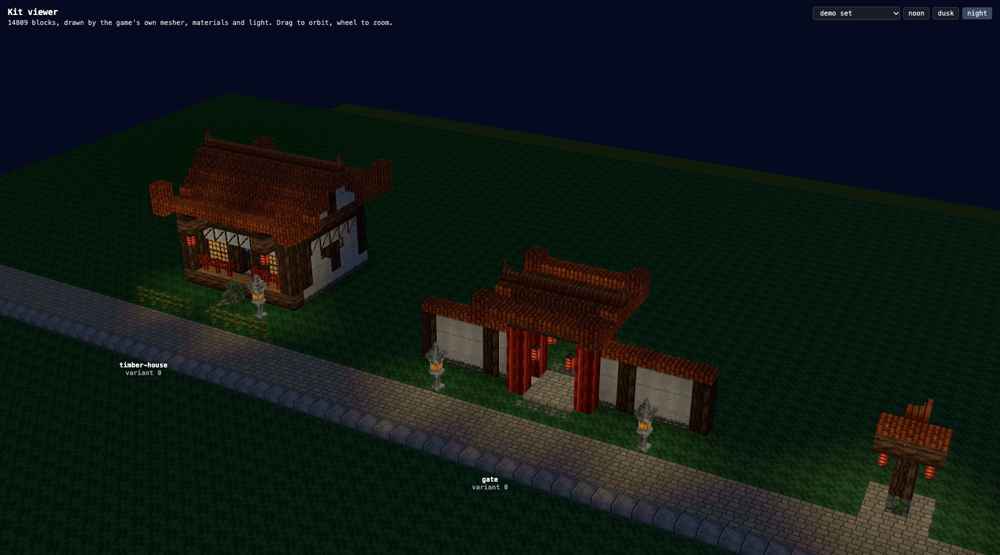

## The layout

`worldgen/tempest/layout.ts` is the owner's plan, `Tempest-6.png`, measured and written down. The binding text is the TOWN PLAN section of `reference/tempest/NOTES.md`; where the picture and that text could not both be followed exactly, the choices are listed under [Deviations](#deviations-from-the-picture).


*Colours: civic white, guest houses green, government teal, public blue, luxury purple, commercial orange, production and storage browns, residences tan, tourism pink (paler where the plan leaves plots empty), farms yellow-green, forest dark green, roads grey (avenues darker), landmarks outlined red, water blue.*

### Frame

**Everything exported by `layout.ts` is in world coordinates and whole cells**, rectangles inclusive (`x0..x1` by `z0..z1`). The picture's origin is the Central Square, **local (0, 0), world (1500, 0)**; `worldX(lx)`, `worldZ(lz)`, `localX(x)` and `localZ(z)` convert, and the tables below give local positions, so add 1500 to x for the world. North is -z. The zone's footprint is a circle of 700 about (1500, 0), its core 550, its ground y = 8 (`TEMPEST_RADIUS`, `TEMPEST_CORE`, `TEMPEST_GROUND`).

### The grid

- Two **avenues** 11 cells wide (cells -5 to 5) cross at the Central Square and run to the edge of the built town, 181 cells from the centre. The built grid is 363 by 363 cells; the plan says about 380 by 360.
- **Blocks** are 38 by 38 cells, separated by streets 6 wide, so the pitch is 44. There are four blocks out each way (`c-4..c-1`, `c1..c4` by `r-4..r-1`, `r1..r4`: column, then row, negative to the west and north) and a street round the edge. The four blocks round the Central Square have their inner corner clipped by 9 cells, the rest by 2.
- **Diagonal streets**, 5 wide, cut corner to corner through the blocks they cross. Two parallel ones in the north west quadrant, running south west to north east (`diag-nw-a` along `x + z = -181`, `diag-nw-b` along `x + z = -137`, each through the corners of its blocks), and one in the north east running north west to south east (`diag-ne`, along `x - z = 181`) in four pieces, one per block it cuts, which is the plan's fan of four. Their ends at the civic compound are its short corner streets.
- The **boundary road** (`boundary-east`, 7 wide, x 183 to 189) runs down the east edge, lined with lamp posts and stalls, and the farms begin beyond it.
- Where the north-south avenue meets the **civic compound** it stops at the compound's front wall. The compound pokes out of the grid, so the north edge street breaks there; two lanes flank it (`lane-compound-west` and `-east`, 7 wide) and a service road (`north-service`) behind it takes the north road.

`blockAt(x, z)` finds the block of a cell in constant time (arithmetic on the pitch, then the clipped corners), `roadAt(x, z)` the road, `districtAt(x, z)` what the cell is for. `BLOCKS` lists the 64 blocks with `id`, `col`, `row`, `rect`, `district`, `density` (dense, normal, sparse, empty), `underConstruction`, `lotSize` (small, medium, large, the hint for the lot planner) and the clip of each corner; `blockById('c2r-3')` fetches one.

### Zoning

Rows run north to south, columns west to east (`*` is a bare plot left as a garden or meadow, `+` is under construction: scaffolds and foundations).

| | c-4 | c-3 | c-2 | c-1 | c1 | c2 | c3 | c4 |
| --- | --- | --- | --- | --- | --- | --- | --- | --- |
| **r-4** | guest | guest | government | government (annex) | public (annex) | public + | public + | public + |
| **r-3** | luxury * | luxury * | luxury + | residential | residential | residential | residential | residential |
| **r-2** | luxury * | residential | residential | residential | residential | residential | residential | residential |
| **r-1** | commercial | commercial | commercial | commercial | residential | residential | residential | residential |
| **r1** | commercial | commercial | commercial | commercial | tourism | tourism | tourism | tourism |
| **r2** | production | production | residential | residential | tourism | tourism | tourism | tourism |
| **r3** | storage | storage | residential | residential | tourism | tourism | tourism + | tourism + |
| **r4** | storage | storage | residential | residential | tourism | tourism + | tourism * | tourism * |

`SECTORS` names the plan's sectors and what they are made of: `civic-compound`, `guest-houses`, `government-residences`, `public-facilities`, `luxury-villas`, `commercial`, `production`, `storage`, `residences-north-west`, `residences-north-east`, `residences-south-west` and `tourism`, each with its block ids and the rectangle round them (`sectorOfBlock(block)` finds the sector of a block; every block is in exactly one). The farms and pastures are the landmarks and `FARMS_EAST` below.

North: the civic compound at the head of the avenue, the guest houses (a park-like quarter on large lots) and government residences to its west, and the long strip of large public plots to its east. North west, the middle band: luxury villas on large lots with gardens. The west half: commerce along both sides of the east-west avenue, production south of it (workshops, forge, weaving hall, lumber yard), storage at the far west (large warehouses and long sheds), dense residences at the south west. Centre east, north of the avenue: dense mixed residences cut by the diagonal. South east: the tourism and entertainment sector, the whole quadrant, big plots, deliberately less dense (inns, bath house, theatre, market hall, formal gardens, a park with a pond, a few construction sites and meadows). The two blocks beside the compound are 12 cells wide annexes (government to the west, public to the east).

### Landmarks

Each landmark has an `id`, a generic `name` (no canon names from the series), a `kind`, a `shape` (rectangle or circle), a `facing` (the side the front or entrance looks, null when it has none), and flags: `parent` (the Town Hall stands inside the compound and may overlap it), `onRoad` (gates and the bridge stand on a road), `optional` (the plan's set pieces). `landmarkAt(x, z)` finds the innermost one at a cell.

| Id | Name | Kind | Local position | Facing |
| --- | --- | --- | --- | --- |
| `central-square` | Central Square | roundabout | centre (0, 0), radius 7 | |
| `civic-compound` | Civic compound | compound | x -24 to 24, z -190 to -140 (49 by 51) | south |
| `town-hall` | Town Hall | hall | x -15 to 15, z -182 to -158 | south |
| `town-hall-forecourt` | Town Hall forecourt | plaza | x -22 to 22, z -156 to -141 | south |
| `compound-lodge` | Compound lodge | hut | x 15 to 21, z -189 to -184 | south |
| `west-gate` | West gate | gate | x -190 to -184, z -9 to 9 | west |
| `north-gate` | North gate | gate | x -9 to 9, z -212 to -206 | north |
| `east-gatehouse` | East gatehouse | gate | x 192 to 198, z -9 to 9 | east |
| `south-gatehouse` | South gatehouse | gate | x -9 to 9, z 184 to 190 | south |
| `west-stalls-north` / `-south` | West stalls | stalls | x -198 to -191, z -33 to -9 and 9 to 33 | east |
| `horse-pasture` | Horse pasture | pasture | centre (-228, 64), radius 34 | |
| `paddock` | Paddock | pasture | centre (-228, -56), radius 28 | |
| `arena` | Arena | arena | centre (176, -250), radius 34 | south |
| `arena-guard-hut` | Guard hut | hut | x 134 to 139, z -243 to -238 | south |
| `north-cave` | Sealed cave | portal | centre (-34, -642), radius 9 | east |
| `cave-pools` | Cave pools (optional) | pools | centre (-64, -622), radius 16 | |
| `south-cairn` | Memorial cairn | cairn | centre (66, 210), radius 12 | west |
| `east-bridge` | East bridge | bridge | x 326 to 348, z -6 to 6 | east |
| `pond-east`, `pond-southeast` | Ponds | pond | centres (199, -38) r 8 and (214, 148) r 11 | |
| `aqueduct` | Aqueduct (optional) | aqueduct | x -176 to -80, z -226 to -218 | east |
| `lumber-clearing` | Lumber clearing (optional) | clearing | centre (-262, -196), radius 30 | |

The **Town Hall** stands at the head of the north-south avenue on its axis, behind a forecourt, with its front looking down the avenue. The **forecourt** is the wide plaza of the reference pictures (fan paving, a bollard line along the compound's south wall). The **north cave** is a decorated, sealed stone portal in a rock face beside the north road, 640 cells out: that is beyond the zone's core (550), in the band where the ground blends into the wilderness, so the portal's rock face has to be built, not carved out of terrain. The arena stands in a clearing north east of the town, its gate on `arena-road`.

### Roads and gates

| Road | Kind | Width | Local position |
| --- | --- | ---: | --- |
| `avenue-ns-north`, `-south`, `avenue-ew-west`, `-east` | avenue | 11 | x or z -5 to 5, out to 181 (north: to the compound at z -139) |
| `street-ns-w1..w4`, `e1..e4`, `street-ew-n1..n4`, `s1..s4` | street | 6 | between the blocks and round the edge |
| `lane-compound-west`, `-east`, `north-service` | lane | 7 | x ±25 to ±31, z -201 to -176; z -201 to -195 |
| `boundary-east` | boundary | 7 | x 183 to 189, z -181 to 181 |
| `road-west` | road | 9 | x -600 to -182, z -4 to 4 |
| `road-north` | road | 9 | x -4 to 4, z -600 to -202 |
| `road-east`, `road-south` | road | 9 | x 182 to 700; z 182 to 700 |
| `arena-road` | link | 7 | x 181 to 187, z -214 to -182 |
| `diag-nw-a`, `diag-nw-b`, `diag-ne` | diagonal | 5 | centre-lines, see above |

**The gates are the RoadNetwork's, exactly.** The west end of the east-west avenue is the road to the Town of Beginnings; the north end of the avenue the road towards Fremmevilla. `ROAD_GATES` repeats `GATES.tempestWest` (world (900, 0), half width 4.5) and `GATES.tempestNorth` (world (1500, -600), half width 4.5) of `worldgen/roads/layout.ts`, and `road-west` and `road-north` lay a straight road 9 cells wide from the grid to each of them, so no bend was needed and the network's road arrives head on, as the roads documentation requires. Inside the core the zone builds these roads; from the gate outwards the RoadNetwork does. `road-east` and `road-south` are plain stubs the network can adopt later. A test builds the RoadNetwork from the seed and checks that its Tempest roads start at these gates, leave them straight away from the town and are as wide as the layout's.

### Beyond the grid

- **Farms** east of the boundary road (`FARMS_EAST`): `farmField(x, z)` returns the field of a cell in the curved radial pattern of the plan, rings of 26 cells and sectors of 3 degrees about the town's centre, so the field edges are arcs and radii. **Pasture** west: the fenced horse pasture and paddock, with a row of stalls and stables on both sides of the west gate road.
- **River:** `RIVER` is a centre-line (a polyline of world points, 7 cells wide) down the east side from the north east to the south, crossing the east road at x 340 under the arched bridge. It stays at least 40 cells from the town and every point of it is inside the core. It is a feature of the zone, not of the terrain generator: the zone step carves it. `riverDistance(x, z)` measures to it.
- **Forest:** `openLandRadius(angle)` is the radius of the cleared land round the town, 270 to 340 cells with an irregular outline; `isWooded(x, z)` is true beyond it, outside the clearings (`isClearing`: the arena's, the lumber one, the cave's) and off the roads. `districtAt` says `forest`, `farm`, `pasture`, `wild` (landmark ground) or `open`.

### Deviations from the picture

Said plainly, because a later step may want to change them:

- **Pitch.** The plan's note says blocks about 38 by 34 and a block plus its street about 42; measuring the picture gave 43 to 45 in both directions. Blocks are 38 square with 6 cell streets (44), which also makes the diagonals pass exactly through block corners.
- **Diagonals.** In the picture each diagonal is drawn as two close parallel lines, which read as the two edges of one street 5 to 6 wide; the north west has one such line pair along `x + z = -181`, the north east one along `x - z = 181`. The plan's text says two parallel diagonals in the north west and a fan of four in the north east. The north east is one street in four pieces, as the picture has it. The north west has two streets, as the text says: `diag-nw-a` is the picture's line pair and `diag-nw-b` is a second one a pitch away, which the picture does not show. Delete `diag-nw-b` from `ROADS` if the picture is meant to win there.
- **The north gate.** The avenue ends at the compound, so the north road cannot continue along it: it comes down x = 1500 to the service road behind the compound and reaches the grid by the flank lanes and the north edge street. The gate position is exactly the RoadNetwork's.
- **River and farms.** The picture shows only a corner of the river; its course past the picture's edge, the bridge and the extent of the farms are ours.
- The picture's labels and canon names are not used.

## Structures

### Blueprint

A `Blueprint` is a volume of cells (block id and state, [engine/cell.ts](engine.md)) a kit draws and a zone stamps into the world. Coordinates are the blueprint's own: x east, y up, z south, any integers. **Convention:** a kit builds with the footprint's north west corner at x = 0, z = 0 and the front towards south, and **y = 0 is the row of the ground surface** (y below 0 is foundation, y above it building).

- A cell is **set** (a block, or air, which *carves*: the stamp clears what stood there) or **unset** (the blueprint says nothing and the ground, a road or a tree stays). `get` returns `NO_CELL` (-1) for unset. It is stored densely over its own bounding box (one `Uint16Array`, unset as 0xffff, a block id no block uses), so a lookup is one array read, which is what a zone's per-block `getBlock` needs; `set` grows the box, `reserve` makes room first.
- `bounds()` is tight, also after `unset`. `forEach` and `cells()` walk bottom to top, north to south, west to east, so order never depends on how the cells were set. `size` counts set cells.
- `hash()` is a stable 32-bit hash of cells and markers: the same building hashes the same whatever order it was drawn in, and any change to a position, block, state or marker changes it.
- `rotated(turns)` (quarter turns clockwise seen from above, east becomes south, about x = 0, z = 0), `mirrored('x' | 'z')`, `translated`, `merge(other, dx, dy, dz, 'over' | 'under')` return new blueprints. **State turns with the building:** stairs, ridge caps with their horns, awnings, curtains and signs (`orientation.ts`; a test checks the table against every model in the registry, so a new stair or oriented block cannot be forgotten). Mirroring swaps a stair's east and west or north and south the right way, and the horn of a ridge cap goes to the other end.
- `markers` are notes that are not blocks: `{ kind, x, y, z, facing?, tag? }`. Kits use `door` (the outward side as `facing`, turned with the building), `tree` (`tag` sakura, cedar, bamboo or any: the zone grows it with its own tree features) and may add `lamp`, `garden` and so on.

### Placement

`new Placement(blueprint, { x, y, z, turns, mirror })` stands a blueprint in the world. The turn is done once, so `cellAt(wx, wy, wz)` (the cell or `NO_CELL`) is a bounds test and one array read: a million lookups take about 10 ms. Also `bounds()` (world), `touches(minX, minZ, maxX, maxZ)` (does it reach this chunk), `stamp(sink)` (every set cell in world coordinates) and `markers()` (in world coordinates). A zone keeps the placements near a chunk and asks them for each block.

### Style packs

A `StylePack` maps **roles** to blocks. Kits never name a block, they ask for the `wall`, the `beam`, the `roofStairs`. The roles: `wall`, `wallFrame` (the half-timber panel), `wallBase` (footing), `trim`, `beam`, `post`, `accent` (lacquered posts and gate colour), `column`; `roofBlock`, `roofStairs`, `roofSlab`, `ridge`, `ridgeHorn` (both equal to `roofBlock` and `ridge` when a roof has no cap, as green glaze and thatch have none); `glassPane`, `shoji`, `shojiLit`, `lattice`, `blind`; `floor` (veranda boards), `interiorFloor`, `path`, `pathAlt`, `curb`, `stone`, `stoneSlab`, `stoneStairs`; `light`, `lightAlt`, `fence`, `rail`, `awning`, `awningAlt`, `noren`, `norenAlt`, `sign`. A pack must define all of them (the constructor checks).

A pack has **families**: a handful of overrides and weights by district, so neighbouring buildings differ while the street still reads as one town. `pack.family(name)` is the complete pack with the palette applied (cached), `pack.pickFamily(rng, district)` picks one by weight, `pack.with({ role: block })` swaps roles. **The Tempest pack** (`worldgen/tempest/style.ts`, `TEMPEST_STYLE`) has the owner's palettes. The base is the commonest house of the town and terracotta is the heaviest weight in every ordinary district (a test samples 2,000 picks per district), so the town reads as one terracotta mass from above:

| Family | Walls and frame | Roof | Weighted for |
| --- | --- | --- | --- |
| `timber-terracotta` | white plaster, dark timber, vermilion accents | terracotta, horned ridge | everything, most of all residential and commercial |
| `plaster-dark` | the same | charcoal ridged tile, dark horned ridge | luxury, guest houses, government |
| `half-timber-green` | half-timber everywhere | green glazed tile, no cap | tourism (inns, the bath), guest |
| `vermilion-dark` | vermilion posts and planks, red and striped lanterns | charcoal ridged tile | luxury, shrines, grander houses |
| `thatch` | plaster, bamboo posts | thatch | storage, huts, stalls, farm houses |
| `civic-teal` | white plaster and columns, plaster stairs | teal standing seam | the `civic` district only |

There is no blue slate anywhere: the block set has none, and a test checks that each family's stairs, slab and block are cut from one roof.

### Roofs: profiles as data

A roof is read from its outer edge towards the crest, a ring at a time, and a **roof profile** (`roofProfile.ts`) says for each ring which shape stands there and how high:

| Shape | A cell at level L holds | Surface |
| --- | --- | --- |
| `block` | a whole cube | L + 1 |
| `slab` | the lower half | L + 0.5 |
| `slabTop` | the upper half, nothing under it (a thin lip seen from below) | L + 1 |
| `stair` | a stair climbing inwards: low step outside, back inside | L + 0.5 to L + 1 |

Levels are blocks above the cell on top of the wall's last course, and `overhang` says how many rings lie outside the wall (the ring over the wall can sit at level 0, rings outside it may dip below). Past the last ring the profile continues with its `tail`: `steep` climbs a block per ring with stairs, `gentle` alternates slab and stair for half a block per ring. The profiles:

| Profile | Rings from the edge | Overhang | Reads as |
| --- | --- | ---: | --- |
| `STEEP` | stair, stair, then steep | 1 | the plain stair roof of a Western gable |
| `GENTLE` | slab, stair, slab, then gentle | 2 | a low, even slope |
| `FLARED` | lip turned up, flat slab, stair, stair, then steep | 2 | **the town's roof**: the eave runs out flat with its tip raised, then the slope steepens, so the surface is concave |
| `FLARED_TIGHT` | lip, stair, stair, then steep | 1 | the same for a narrow roof (a porch, a gate) |
| `FLARED_DEEP` | lip, three flat slabs, stair, slab, stair, stair, then steep | 3 | the big roofs, a longer, lower sweep |

`FLARED` needs a span of eleven or more across the ridge to show its curve; the roof builders take the profile as an option, so changing the data changes every roof built from it. The builder's roofs (`gable`, `hip`, `hipGable`, `eaves`) are in the table below; `tips` raises the four eave corners (in half blocks: 2 is a block higher than the lip, 3 also lifts the cells beside it), `ridgeCap` puts the style's ridge on the crest with horned ends. All roofs close (every column under them has a roof block), have no floating blocks and stay out of the wall volume, which the tests check for every profile, size and shape.

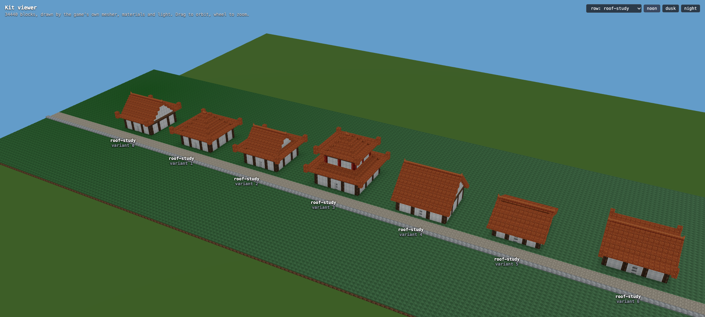

### The builder

`new BlueprintBuilder(style, rng, name)`; `.build()` returns the blueprint. A block argument is a **role**, a block id or `{ id, state }`. Coordinates are the blueprint's, ranges inclusive, `rect(x0, z0, x1, z1)` makes a `Rect`. Directions are `NORTH`, `EAST`, `SOUTH`, `WEST` (0 to 3, the order stairs and models turn).

| Group | Helpers |
| --- | --- |
| Solids | `set`, `setIfEmpty`, `carve`, `clear`, `box`, `hollowBox` (with `top` and `bottom`), `floor`, `ring` |
| Walls and openings | `walls(rect, y0, y1, block, openings)`; `opening(rect, { side, at, y, width, height, kind, lit, noren, sill })` with kinds `door` (2 high, marks the door, an optional noren), `open`, `arch`, `window`, `glass`, `shoji` (`lit` for the glowing screen), `lattice`, `blind`; throws if it does not fit the wall |
| Timber | `column`, `columns`, `beam`, `beamRing`, `frame(rect, y0, y1, { panel, post, beam, spacing, beams, footing })` |
| Roofs | `gable(wall, plateY, { profile, axis, tips, gableWall, endOverhang, ridgeCap })`, `hip`, `hipGable` (hips round the edge, a gable above, the triangles standing back), `eaves(outer, baseY, rings, profile, tips)` (the skirt of a lower storey, returns the rectangle inside it for the next storey), `ridgeCap`; each roof returns `{ outer, base, top, crestTop, gable }` |
| Verandas and balconies | `engawa(rect, y, side, depth, { from, to, rail, posts, gap, postTop })`, `balcony(rect, y, side, from, to, depth, { rail, bracket })`, `railing`, `fence`, `fenceRect` |
| Hanging things | `lanternHanger`, `awning(wallCoord, from, to, y, out, { alt })`, `signboard`, `noren`, `chimney` |
| Steps | `stair`, `steps(x, y, z, out, count, width)` (down and out from a doorway, climbing back) |
| Garden | `pond(rect, y, koi, rim)` (water, a stone rim and koi), `steppingStones`, `steppingPath`, `treeSpot` (a marker), `stoneLantern`, `lampPost` |
| Interiors | `room(interior, floorY, { doors })`, `tatami(room)` (mats on the floor row's cells above it), `furnish(room, items)`: furniture with a preference for walls, corners, the middle or anywhere, never on or beside the cells a door opens onto |

`furnish` is deterministic: it draws from the builder's own generator. Furniture stands on the cell above the floor row, replacing the tatami there. `markers`: `door` is added by `opening` for doors; `treeSpot` adds `tree`.

### Lots, kits and the registry

A **`Lot`** is a plot a building stands on: `id`, a world rectangle (`x`, `z`, `w`, `d`), the `facing` of its front (0 north to 3 west), `district`, `seed`, `floors` (a hint, 1 to 3), `neighbours` (left, right and back, each `{ kind, height, family? }`), an optional `family` the planner chose so neighbours differ, and `groundY`. **A kit never thinks about the four directions:** it builds in its own frame, front south and corner at (0, 0), and `lot.frontage` (the footprint's width along the front) and `lot.depth` are its sizes whatever the lot's facing. `lot.place(blueprint)` returns a `Placement` that turns the finished building to face the street and puts the footprint on the lot's rectangle (a test does this for all four facings and checks the footprint stays on the rectangle and the door looks the lot's way).

A **`BuildingKit`** has a `name`, `frontage` and `depth` limits (`KitSize`), `floors`, `variants`, `preferredSize(variant)` (for the viewer and tests), `fits(lot)` and `build(lot, style, rng, variant)`. `buildWithKit(kit, lot, style, variant)` does it the standard way: the generator is the lot's seed forked by the kit's name and the variant (`kitRng`), and the family is the lot's or the style's pick for its district. Same lot, same building.

A **`KitRegistry`** holds kits with weights by district (`register(kit, { residential: 3, commercial: 1 }, fallback)`), `candidates(lot)` (those that fit its size and storeys with a weight above zero), and `pick(lot, rng?)`, which chooses by weight with the lot's own seed and returns null when nothing fits. `createTempestKits()` (`worldgen/tempest/kits/index.ts`) is Tempest's registry: the placeholder box house for every district and the demonstration kits with no district weight (a planner places them by name). The district kits of step 7.2b have their own registry, `createTempestKitRegistry(style)` in `worldgen/kits/tempest/index.ts` (see [The district kits](#the-district-kits)).

The **`BoxHouseKit`** is the placeholder: a walled box with a door, windows and a plain hip roof in whatever style it is given, any size from 5 by 5, one to three storeys. It exists so the zone works before the real kits arrive, and to try a new style pack on a building.

## How to write a kit

1. **Subclass `BuildingKit`.** Give it a unique `name`, `frontage` and `depth` limits, `floors`, and `variants` if it makes more than one building.
2. **Build in the kit's frame.** Front south, footprint x from 0 to `lot.frontage - 1`, z from 0 to `lot.depth - 1`, y = 0 the ground row. Leave room in the footprint for the eaves: the roof overhangs the walls by the profile's `overhang`, and an odd span across the ridge (walls plus twice the overhang) closes on a ridge cap.
3. **Use roles.** `b.walls(rect, 1, 3, 'wall')`, not a block id. Take the pack from the argument; never import `TEMPEST_STYLE`. A block id is fine for things with no role (the stepping stones, the koi pond).
4. **Take everything that varies from `rng` and `variant`**, never from `Math.random` or the clock.
5. **Mark doors and trees** (`opening` marks doors, `treeSpot` marks trees) so the planner can join paths and the zone can plant.
6. **Check it in the viewer** (`?sandbox=kits&kit=name`, then `&row=name`, `&view=eye`, the three skies, `&facing=1`).
7. **Add it to `createTempestKits()`** with its district weights. Tests that run on every registered kit and variant (`tests/structures/kits.test.ts`) cover determinism, staying inside the lot, no floating blocks in any palette family, and clear doors.

A small kit, the shape every kit has:

```ts
export class ShopKit extends BuildingKit {
  readonly name = 'shop';
  readonly frontage: KitSize = { min: 11, max: 15 };
  readonly depth: KitSize = { min: 11, max: 15 };
  readonly floors: KitSize = { min: 2, max: 2 };

  build(lot: Lot, style: StylePack, rng: Rng): Blueprint {
    const b = new BlueprintBuilder(style, rng, this.name);
    const walls = rect(2, 2, lot.frontage - 3, lot.depth - 3);        // the eaves take two blocks all round
    b.floor(walls, 0, 'wallBase');
    b.frame(walls, 1, 6, { panel: 'wall', post: 'post', spacing: 4, beams: [3] });
    b.beamRing(walls, 7, 'beam');
    b.opening(walls, { side: SOUTH, at: 4, y: 1, width: 2, kind: 'door', noren: true });
    b.awning(walls.z1, walls.x0 + 1, walls.x1 - 1, 4, SOUTH, { alt: true });
    b.hipGable(walls, 7, { profile: FLARED, tips: 2 });
    return b.build();
  }
}
```

## The kit viewer

`?sandbox=kits` shows kits through the game's own mesher, texture array and materials, on flat grass with a street along the fronts, with the block light baked in the way the world's workers bake it. The sky is the game's own sky model inside Tempest's atmosphere (`computeSky` for noon, dusk and night), so lanterns and lit shoji screens are on at dusk and night. Drag to orbit, wheel to zoom, right-drag to pan; the top right has a kit selector and the sky buttons. It raises `window.__SHOT_READY__`, so `node bench/run.mjs --shot` works on it.

| Option | Does |
| --- | --- |
| `kit=timber-house&variant=2` | one kit and variant (default: the demonstration set, `DEMO_KITS` in `KitSandbox.tsx`) |
| `row=timber-house` | every variant of a kit side by side |
| `sky=noon` / `dusk` / `night` | the sky preset (noon by default) |
| `family=plaster-dark` | forces a palette family (default: the lot's own pick, the style's weights) |
| `seed=7&w=15&d=13&floors=2&facing=1` | the lot: seed, footprint along the front and in depth, storeys, which way the front looks |
| `view=iso` / `front` / `back` / `side` / `top` / `eye` | camera presets; `eye` stands in the street at eye height with a 62 degree view |
| `az=30&el=20&zoom=1.4&fov=50` | swing, elevation, nearness and field of view of the preset |
| `cam=px,py,pz,tx,ty,tz` | an explicit camera, in display coordinates |

```bash
node bench/run.mjs --width 1800 --height 1000 --url "http://localhost:3105/?sandbox=kits&family=timber-terracotta&el=26&zoom=1.2" --shot docs/screens/p7/kits-demo.png
node bench/run.mjs --width 1800 --height 1000 --url "http://localhost:3105/?sandbox=kits&sky=night&family=timber-terracotta&el=26&zoom=1.2" --shot docs/screens/p7/kits-demo-night.png
node bench/run.mjs --width 2000 --height 900 --url "http://localhost:3105/?sandbox=kits&row=roof-study&family=timber-terracotta&el=30&zoom=1.1" --shot docs/screens/p7/kits-roofs.png
node bench/run.mjs --width 1600 --height 900 --url "http://localhost:3105/?sandbox=kits&kit=timber-house&variant=1&view=eye&sky=dusk&family=timber-terracotta" --shot docs/screens/p7/kits-eye.png
```

`kitsLayout.ts` is the pure half (`parseKitSandbox`, `buildKitStage`, `kitFrame`, `kitLook`) and is tested without a browser; `SandboxView` gained a `look` (daylight, sky light colour, background, lit or not) and an `overlay`, and `defaultCamera` a `zoom`, which the other sandboxes leave at their defaults.

## The demonstration kits

They prove the builder and are what the viewer shows. None is a district kit: the district kits are in the next section.

- **`timber-house`** (13 by 14, three variants): a raised floor on a stone footing, plaster walls in a dark frame, lit shoji screens either side of a door with a noren, lattice windows on the other walls, a veranda with posts to the eave and a rail, steps to a yard with stepping stones, a stone lantern, a bamboo fence and a sakura marker, red lanterns hung from the eave, and inside a tatami room with a low table, cushions, futons, a bookshelf, a hearth and a vase. Variant 0 has a gable roof with a king post in each plaster gable, 1 a hip and gable, 2 a hip, all `FLARED` with raised corners and horned ridge ends.
- **`gate`** (17 by 7, two variants): a roofed gate with four lacquered posts, a tie beam and lintels, a low flared gable roof with horned ends, lanterns hanging in the passage, plaster walls with tile caps on either side, stone lanterns outside. Variant 1 has dark timber posts and a signboard.
- **`lantern-post`** (3 by 3, three variants): a lamp post with two paper lanterns and a small roof, a stone lantern on a mossy bed, a post carrying a lump of blue magic ore.
- **`roof-study`** (a test bench, seven variants): the same walls under each roof, one variant each: gable, hip, hip and gable, two storeys with a skirt roof under a hip, a steep gable, a gentle one, a deep flare.

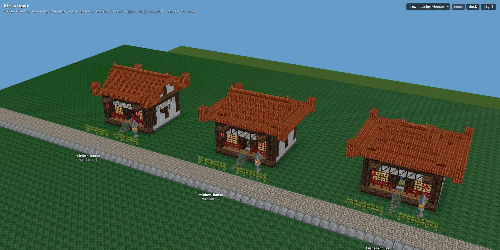
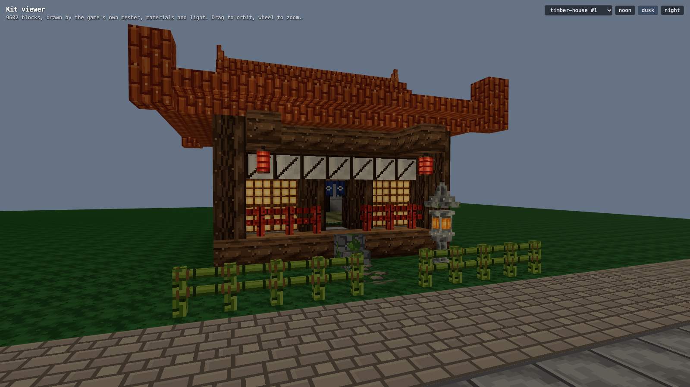
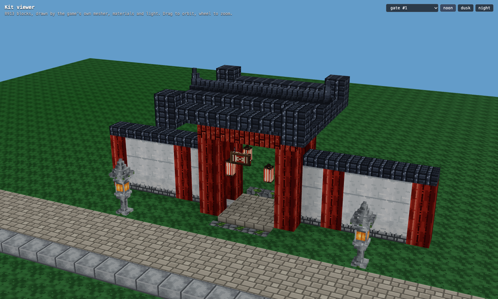

### What is still missing, side by side with the pictures

Honestly, comparing the viewer with Tempest-3, -4, -5 and -7:

- **Upswept eaves** are there (raised lips, corner tips, horned ridge ends) but the corners are blocky: a tip is a column of two cubes, where the pictures' pagoda eaves curve in a long sweep. `tips: 3` lifts the cells beside the corner too, which helps; a true curve would want a flared tile block with its own model, and ids 128 to 199 are used up (ids 200 to 255 are free).
- **Western gables** (Tempest-5's steep gables beside the pagoda roofs) are the `STEEP` profile and exist as a roof; no kit uses them yet.
- **The neoclassical hall** (Tempest-3) is for the landmark step: a flatter pediment, arched windows, three gables. The builder has the pieces (`white_column`, hip roofs in teal, `civic-teal`) but not a pediment helper.
- **Yurt domes, the aqueduct and the glowing terraced pools** are not built; the layout reserves their places.
- **Street life:** noren, awnings, signs, barrels and laundry exist as helpers and are used on the demonstration house and gate, but the town's streets will only look lived in when the district kits use them all.
- **Plaster is greyer** than the pictures' white at noon; that is the tile, not the builder.

## The district kits

Step 7.2b: the buildings the planner puts on the lots, in `worldgen/kits/tempest/`, one file per kit, `parts.ts` (bays, windows, roofs over a wall, stairs, furniture, props) and `garden.ts` (ponds, paths, stones and trees) shared between them. They are pure `BuildingKit` classes: no Three.js, no block ids that a style pack supplies, and everything that varies comes from the lot's seed, the variant and the palette family, so a lot always gets the same house and two lots never get the same one. `createTempestKitRegistry(style)` registers them all with district weights and fails at start-up (not on a worker's first lot) if the pack has no families.

Every kit is built in the kit frame (front south, footprint from the corner at 0, 0, `y = 0` the ground), is **mirrored** left to right on a coin toss of its seed, and shows these things: wall detail (a stone or plaster footing, posts every four or five blocks, plaster or half-timber panels, beams at each floor), windows (lit shoji at the front, lattice, glass or blinds at the sides and back), a roof with flared eaves, raised corners and ridge caps, and a few props at the door. Houses have a floor, tatami, a few furnishings and a stair to the upper storeys (`furnishRoom`); the richer interiors come from the landmark step. Roofs are never plain boxes: the profile (`FLARED`, `FLARED_TIGHT`, `STEEP`) and the roof shape (hip, gable, hip and gable, tiers of skirt roofs) change with the variant and the lot.

### The kits

| Kit | Variants | Lot (frontage by depth) | Storeys | What the variants are |
| --- | ---: | --- | ---: | --- |
| `townhouse` | 4 | 9 to 17 by 10 to 18 | 1 to 2 | 0: two storeys, a porch under a balcony on posts, an irimoya roof (hip and gable). 1: two storeys under a steep half-timbered gable to the street, a canopy over the door (the Western gable of Tempest-5). 2: tiers, a skirt roof round the ground floor and a smaller storey above under a hip with raised corners. 3: one storey, a veranda along the front, a long gable roof, a yard with a fence, stepping stones and a stone lantern |
| `shop` | 3 | 9 to 17 by 10 to 17 | 1 to 2 | 0: an open timber front under a tiled lean-to eave, counter between the posts, noren, goods, a blade sign. 1: sliding screens and a door under a deep striped awning, a sign board, barrels and crates outside. 2: an arcade, the upper floor on posts over a covered walk. A chimney and a planter on a roll |
| `inn` | 2 | 15 to 27 by 17 to 29 | 2 to 3 | 0: tiers, each storey two blocks in from the one below under a skirt roof of its own, a hip on top, a veranda of vermilion posts all round. 1: one long gable roof over two storeys, a lean-to over the veranda, a courtyard garden behind |
| `shrine` | 2 | 15 to 31 by 21 to 37 | 1 | 0: the full complex, a vermilion torii at the street, a long paving path between stone lanterns, a purification basin under a roof, steps to a terrace and the hall (hip and gable, shimenawa across the front), a side shrine and a sacred tree. 1: a wayside shrine with two torii one behind the other and a small gabled hall. The lacquer is vermilion in every palette family |
| `watchtower` | 2 | 11 to 15 by 11 to 15 | 2 to 3 | 0: a stone base with arrow slits, two timber storeys with lit screens and a vermilion rail, skirt roofs, the top under a hip with a ridge cap. 1: a fire watch, one closed storey and an open lookout under a hip with a bell and a blue ore beacon. A straight flight through the base and a spiral round the narrow storeys above |
| `storehouse` | 2 | 9 to 17 by 10 to 18 | 1 to 2 | the kura. 0: one storey under a long gable roof, a small eave over the door. 1: two storeys, a skirt roof round the stone-footed ground floor and a gable above. White plaster on a plinth, small deep windows, one big lacquered door |
| `garden-house` | 2 | 17 to 29 by 17 to 29 | 1 to 2 | 0: a tea house at the back of a pond garden (stepping stones, a small arched bridge, lanterns, trees), a veranda on the front and one side. 1: a two storey villa at one side with a dry garden of raked gravel, boulders and bamboo |
| `garden-plot` | 2 | 9 to 27 by 9 to 27 | 1 | a lot with no house. 0: a pond garden, a bamboo fence with a gate, koi, a bridge, a bench, lanterns, places for sakura and cedar. 1: a kitchen garden with furrows, a scarecrow, crates and a tool hut |
| `market-stall` | 3 | 7 to 11 by 6 to 9 | 1 | four posts, a counter with stock, crates and barrels behind it, red lanterns for the evening. 0: a small tiled hip with horned ridge ends. 1: a striped cloth awning on a frame, higher at the back, a sign board. 2: a tent of roof stairs, a rack of washing |
| `well` | 2 | 5 to 9 by 5 to 9 | 1 | a ring of mossy stone, two posts and a beam with a bucket. 0: a small gable roof, fan paving, stone lanterns. 1: a plain rope well with barrels, crates, a bench and planters |
| `river-bridge` | 2 | 5 to 13 by 9 to 49 | 1 | the span is the lot's **depth**, the width its frontage. The deck climbs a block a block to a crown that follows the span (`RiverBridgeKit.deckHeight`: one block high on 9 cells, four on 20 or more), with abutments sunk 6 blocks below the bank and piers every twelve blocks on a long span. Nothing is carved. 0: stone, a paved deck, a vault of mossy stone, stone lanterns, optional blue and green ore lamps on the crown. 1: timber, planks on beams and trestle piers, vermilion rails and newels, paper lanterns |

That is **26 buildings** (variants), and `tests/kits` counts 26 different blueprint hashes at one seed and palette family. Beside the variants, the style family changes the walls, frame and roof of a given kit (six families, see [Style packs](#style-packs)), and the seed changes the mirror, where the door is, planters, chimney, window kind, trees and goods, so one lot size and variant gives at least four different buildings over twelve seeds (a test).

### Registry and district weights

`createTempestKitRegistry(style)` offers, for a lot, the kits that fit its size and storeys with a weight above zero for its district, and picks by weight with the lot's own seed. The districts are the layout's, plus the lot kinds the planner may add on top of them: `market` (stalls round a square), `shrine`, `forest-edge` (where the town meets the trees) and `bridge`.

| Kit | Weights (district: weight) |
| --- | --- |
| `townhouse` | residential 8, production 3, commercial 2, government 2, public 2, forest-edge 2, luxury 1.5, guest 1, tourism 1, storage 1 |
| `shop` | commercial 8, market 5, tourism 3, production 2, public 1, residential 0.5, civic 0.5 |
| `inn` | tourism 6, guest 3, commercial 1, public 1, residential 0.2 |
| `shrine` | shrine 10, tourism 0.8, forest-edge 0.5, luxury 0.2, residential 0.05 |
| `watchtower` | civic 2, forest-edge 2, government 1, public 1, storage 0.3 |
| `storehouse` | storage 8, production 4, public 2, forest-edge 2, government 1, civic 1, residential 0.4 |
| `garden-house` | luxury 8, guest 6, government 3, tourism 2, residential 0.4 |
| `garden-plot` | luxury 3, guest 3, tourism 3, civic 2, public 1, shrine 1, forest-edge 1, residential 0.7, commercial 0.2 |
| `market-stall` | market 6, commercial 3, tourism 3, production 0.5, residential 0.3 |
| `well` | civic 2, residential 0.6, production 0.5, forest-edge 0.5, shrine 0.5, commercial 0.3, luxury 0.3 |
| `river-bridge` | bridge 10 |

The kits do not decide the palette family: the planner passes `lot.family` (so neighbours differ) or the style's weights for the district pick one. A district whose lots no kit fits (a three block lot) gets `null` from `pick`, and the test of the registry checks that every district of the layout gets something on a range of lot sizes and that a dense residential lot is a townhouse more than half the time.

### Looking at the kits

`?sandbox=kits&row=townhouse` shows every variant of a kit in a row; the kits are in the viewer's list by name. The screens below are rows at noon (palette family chosen by the lot, so rows mix terracotta, dark tile, green glaze and thatch), at dusk at eye level and at night, where the lanterns and the lit shoji glow.

```bash
node bench/run.mjs --width 1800 --height 860 --url "http://localhost:3107/?sandbox=kits&row=townhouse&el=26&zoom=1.55" --shot docs/screens/p7/kits-townhouse.png
node bench/run.mjs --width 1800 --height 800 --url "http://localhost:3107/?sandbox=kits&row=townhouse&view=eye&fov=80&sky=dusk&family=timber-terracotta" --shot docs/screens/p7/kits-street-eye.png
node bench/run.mjs --width 1800 --height 860 --url "http://localhost:3107/?sandbox=kits&row=shop&el=24&zoom=1.5&sky=night" --shot docs/screens/p7/kits-night-shop.png
```

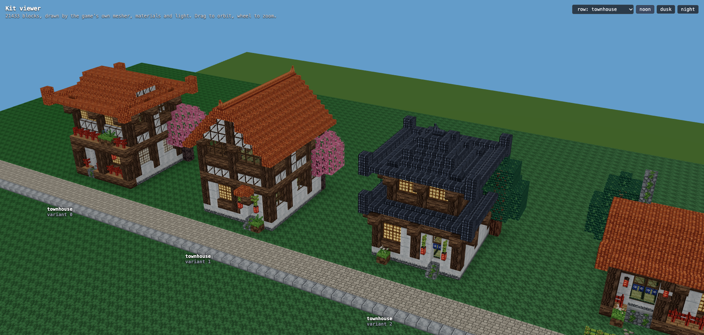
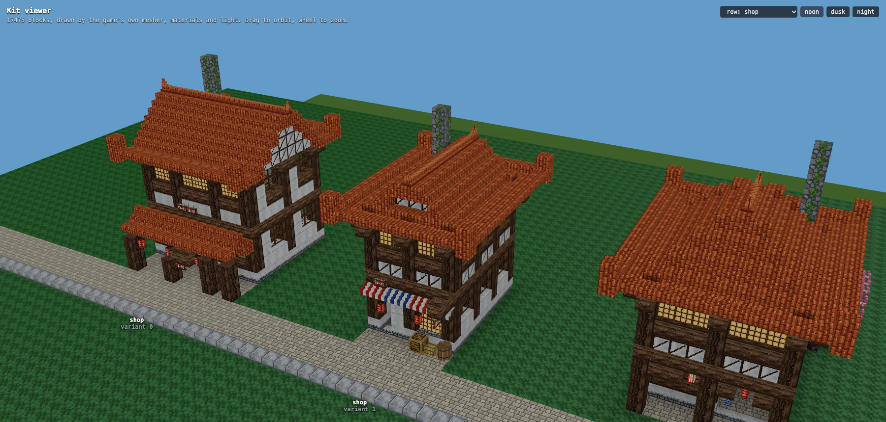
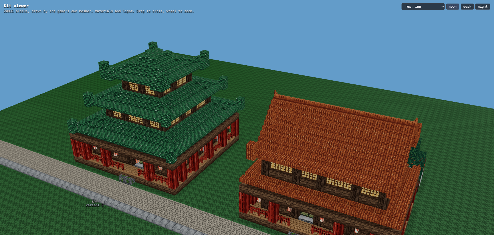
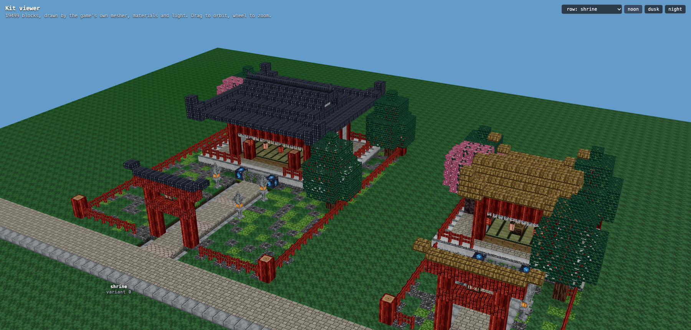
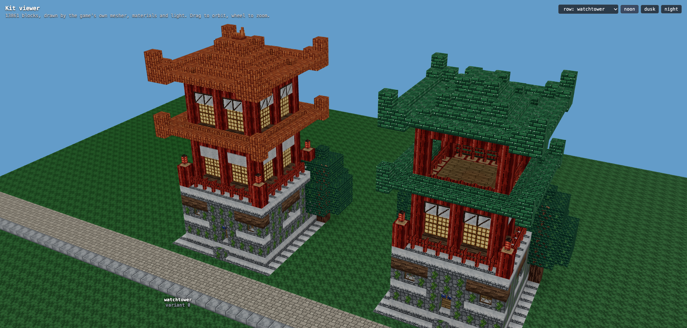
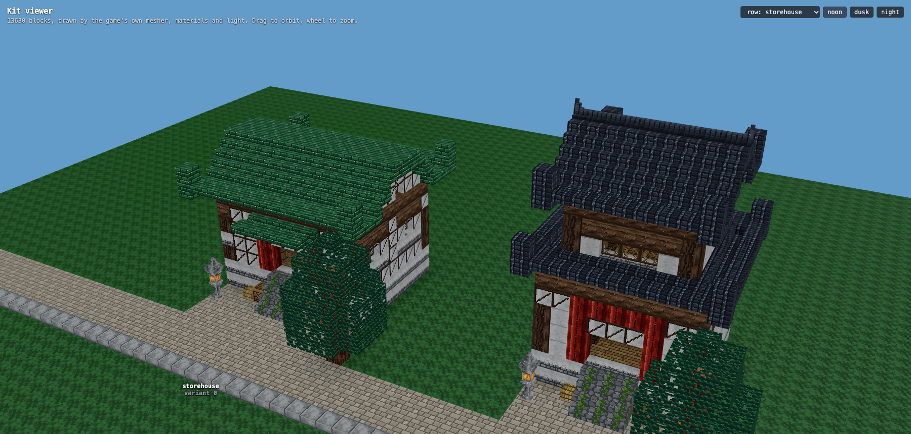
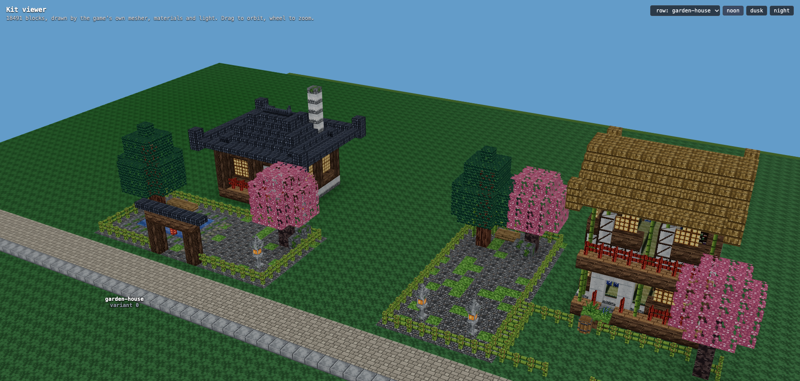
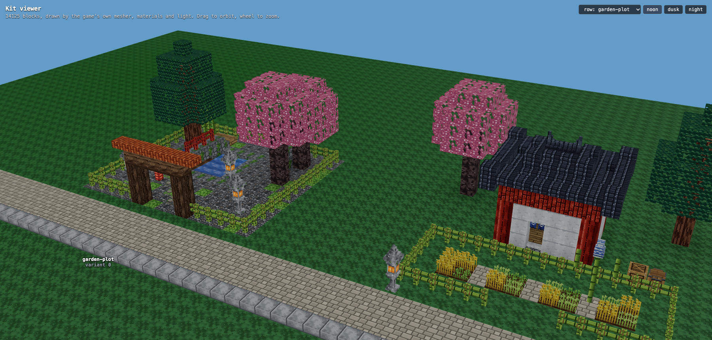
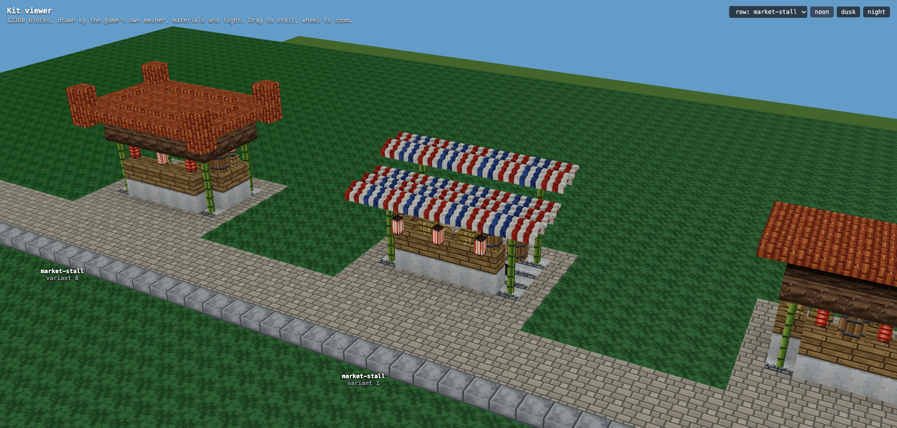
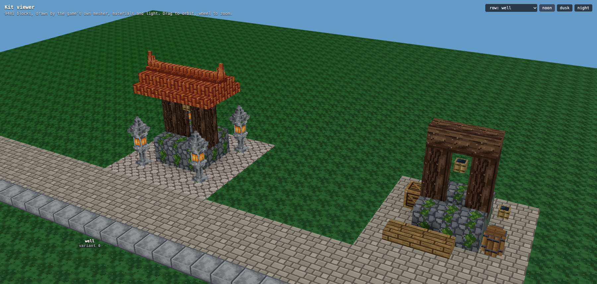
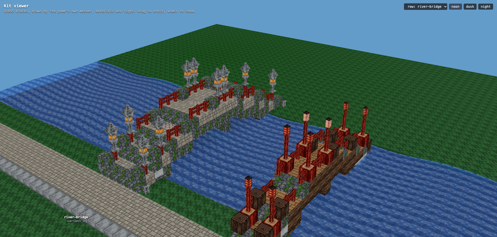
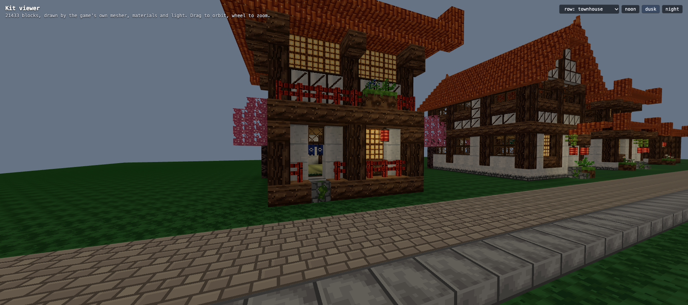
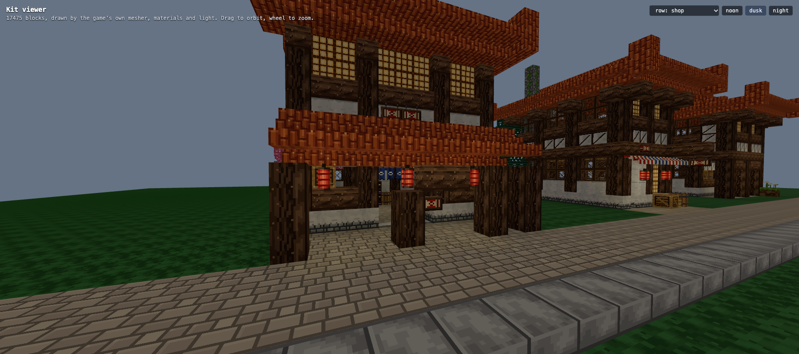
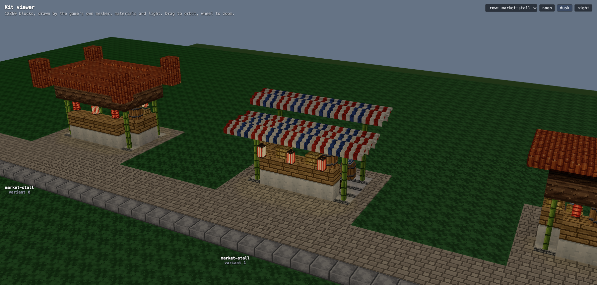
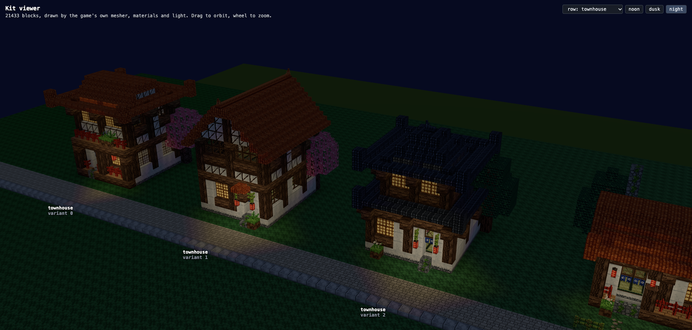
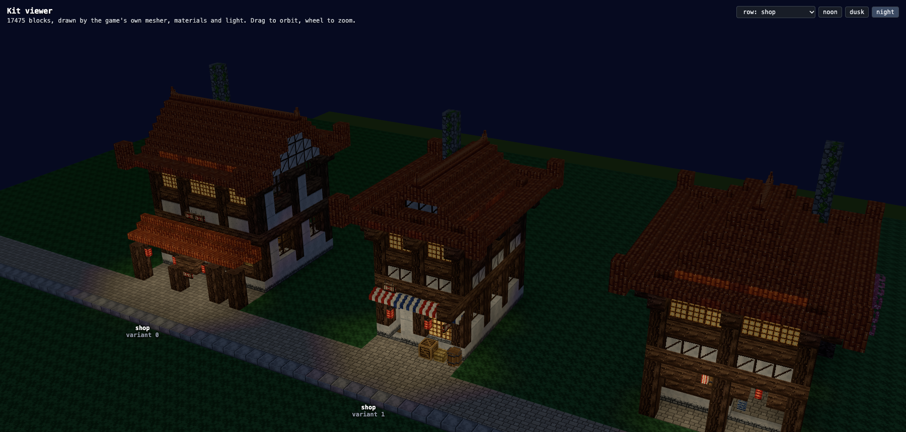
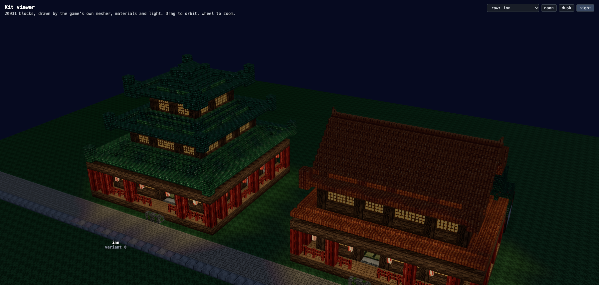
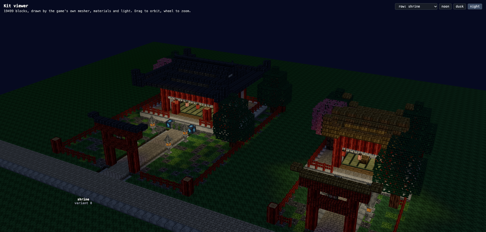

### Judged against the pictures

Honestly, next to Tempest-3, -4, -5 and -7:

- **What is there:** a terracotta town (the heaviest weight in every ordinary district), dark timber against white plaster, half-timber gables, upswept roofs with horned ridge ends beside plain steep Western gables, deep eaves and awnings over the shop fronts, red and striped paper lanterns at doors and eaves, noren, signs, crates and barrels, shoji that glow at night, a stone footing and moss. The tiers of the inn and the watchtower read as pagoda roofs from a distance, and the dark ridged tile of `plaster-dark` and `vermilion-dark` reads as the heavy Japanese tile of Tempest-5.
- **Still missing or weak:** the eave corners are blocky (two cubes up, see the roof section above). The big inns (27 by 29) have large, plain roof planes: no dormers, no secondary gables. The smallest lots (9 by 10) give a house that is mostly roof. Shop signs are small, since a sign is a block, and there are no shop fronts with glass display windows like the left of Tempest-3 or the lettered signs of Tempest-4 (no script in the block set, on purpose). The night lighting is modest: a lantern lights a few blocks, so a street needs lanterns every four or five blocks to read as lit (the planner's lamp posts and the zone's street furniture are for that), and nothing beats the glow of Tempest-4's hanging lanterns until a street is built. The hip and gable roofs show their gable triangle as a recess set back in the roof, which reads as a dormer from the front and as a notch from the side. Yurts, the neoclassical hall, the aqueduct and the pools are not here (landmarks).
- **Not tried:** very narrow lots (the kits refuse a lot outside their frontage and depth limits and the registry offers them nothing else), a street where two kits of one family stand side by side with the same roof shape; the planner's `family` hint is what keeps neighbours apart.

## Tests

| File | Covers |
| --- | --- |
| `tests/structures/blueprint.test.ts` | cells, negative coordinates and growth, tight bounds, set order, hash, turning and mirroring (states of stairs, horns, awnings, markers), merge, the orientation table against the registry, `Placement` (every turn and mirror against the turned blueprint, markers, a million lookups) |
| `tests/structures/builder.test.ts` | boxes, shells, floors; roles, ids and states; door openings carved and marked, windows filled; frames; steps, awnings, signs, ponds, lanterns, tree markers, the engawa; roof profiles; **roofs closed, no floating blocks, outside the wall volume, symmetric, ridge and horns, raised corners** for every roof kind, profile and several sizes; furniture and the door path; every role of every family is a registered block |
| `tests/structures/kits.test.ts` | `Lot` turned to every facing, the registry, the Tempest style pack and its weights, and every kit, variant and palette family: deterministic, inside the lot, no floating blocks, clear doors, the box house without a gap |
| `tests/kits/tempestKits.test.ts`, `tests/kits/analysis.ts` | every district kit, variant, palette family and seed: deterministic, every cell a real block in a legal state, **inside the lot** at the smallest and largest lots and storeys, turned to every facing with the footprint on the lot, **no floating blocks** (a flood from the ground over support, `floatingCells`), **no unsupported roofs** (`unsupportedRoof`), **an entrance reachable from the street and room to stand inside** (`walkFrom`: a walk over the blueprint with the player's height, steps, stairs and slabs), a way up to every upper floor, **windows that let the light through** and lit ones that glow, every palette family gives a different building, **seeds and variants never look the same twice**, **at least 14 different blueprint hashes** (26), markers inside the footprint, the bridge at every span and width, the registry by district, and the build time |
| `tests/tempest/layout.test.ts` | the grid, blocks apart from each other and the roads, zoning against the plan, diagonals, landmarks (unique, in the footprint, not overlapping, off blocks and roads unless built on one), the Town Hall at the head of the avenue, the arena, cave and cairn, **the gates equal the RoadNetwork's and its roads (built from the seed) start there**, the river, farms and forest |
| `tests/worldgen/structures-purity.test.ts` | the new layers import no Three.js, React or DOM, and the engine and content do not import them |
| `tests/kitSandbox.test.ts` | the viewer's options, stage, camera and light, meshed with the real mesher |

Measured on the development machine: the 97 tests of the structures, the layout, the viewer and the purity check run in about a second and a half (the whole suite, 1,785 tests, in 17 seconds); building a house blueprint takes under a millisecond, and `blockAt` is arithmetic.

Blueprint build time of the district kits at their preferred size (average of ten seeds, milliseconds, measured with the whole suite running beside two other jobs): townhouse 0.89, 0.30, 0.33, 0.18; shop 0.31, 0.28, 0.33; inn 0.87, 0.47; shrine 0.28, 0.09; watchtower 0.29, 0.22; storehouse 0.18, 0.21; garden house 0.20, 0.31; garden plot 0.04, 0.10; market stall 0.04, 0.01, 0.02; well 0.02, 0.01; river bridge 0.26, 0.05. The test bounds the worst of them at 60 ms (scaled for a busy machine), a hundred times the worst measured, so a slow machine does not fail it but a quadratic kit would.
