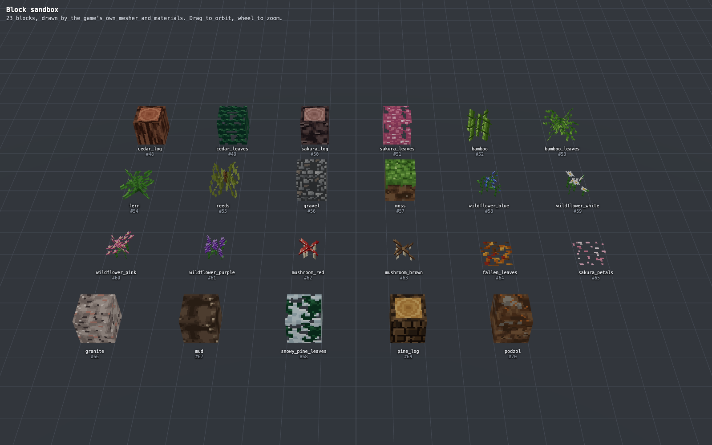

# Block textures

Phase 3 replaces flat block colours with 16x16 pixel-art tiles that are generated in code, not drawn in an editor and not loaded from files. This page covers the pure side, `content/textures/`. Packing the tiles into a mipmapped texture array and drawing with them is covered in [Texture array](#texture-array) below.

The folder follows the layer rules for `content/`: no Three.js, no React, no DOM, no Node modules and no `Math.random`, so a worker can run it. A test checks all of that.


`npm run textures:sheet` rewrites that image (`npx vite-node bench/textureSheet.ts [out.png]`). It has three parts: every tile at 6x with its name (cutouts sit on a checkerboard), the grass tiles under each zone's colour, and the tiles that are meant to repeat, shown 2x2 so a bad seam is easy to spot. The PNG is written by `bench/png.ts`, a small encoder on `node:zlib`.

## Pieces

| File | What it is |
| --- | --- |
| `TextureRecipe.ts` | The abstract `TextureRecipe`: an `id`, `generate(rng)` returning 1024 bytes (16x16 RGBA, row 0 on top), plus `opaque`, `tiling` and `tint` flags. |
| `Rng.ts` | `SeededRng` (mulberry32) and `hashString`. Every tile has a fixed default seed, the hash of its name. |
| `Pixels.ts` | Hex colours, palettes, `ramp` (pick a shade by value) and `Canvas`, a 16x16 RGBA buffer whose coordinates wrap. |
| `noise.ts` | Wrapping value noise (`tileNoise`, `layers`), `ranks`, wrapping Voronoi cells and diagonal vein waves. Everything wraps at the tile edge, so patterns built from it tile without extra work. |
| `recipes/` | The recipe classes, grouped as `natural`, `masonry`, `wood`, `materials`, `plants`, `wilds` (cedar, blossom and snowy pine foliage, gravel, moss, granite, mud, podzol and the soil sides) and `undergrowth` (bamboo, fern, reeds, wildflowers, mushrooms and the litter carpets). |
| `TextureCatalog.ts` | Names mapped to recipes. `createDefaultCatalog()` registers the 77 tiles below. |
| `tint.ts` | `applyTint(pixels, mask, rgb)`, the multiply the renderer does for tinted tiles (the shader does the same). |
| `layout.ts` | `createDefaultTextureLayout(registry)`: describes the catalog to `engine/TextureLayout` and builds the layout the game uses. |
| `recipes/plants.ts` | `TallGrass`, `Sugarcane`, `Flower`, `LilyPad` and `Apple`, the cutout tiles of the small plants. |

```ts
import { createDefaultCatalog } from './content/textures/TextureCatalog';

const catalog = createDefaultCatalog();
catalog.names();                     // registration order
catalog.render('stone_brick');       // Uint8Array(1024), same bytes every time
catalog.render('stone_brick', 7);    // another variation of the same material
catalog.get('leaves_oak').recipe.opaque;   // false: alpha is 0 or 255, never in between
catalog.tintMask('grass_side');      // Uint8Array(256), 255 where the biome colour applies
```

## Tiles

| Group | Names |
| --- | --- |
| Terrain | `grass_top`, `grass_side`, `dirt`, `stone`, `sand`, `snow`, `water`, `path`, `farmland`, `basalt` |
| Crops and plants | `wheat_stage_1`, `wheat_stage_2`, `wheat_ripe`, `tall_grass`, `sugarcane`, `flower_yellow`, `flower_red`, `lily_pad`, `red_apple` (cutouts, for crossed quads or small boxes) |
| Trees | `log_side`, `log_top`, `birch_log_side`, `birch_log_top`, `leaves_oak`, `leaves_birch`, `leaves_pine` (cutouts) |
| Masonry | `cobble`, `mossy_cobble`, `stone_brick`, `brick_red`, `brick_factory`, `plaster`, `marble`, `roof_red`, `roof_blue`, `hangar_wall` |
| Wood | `plank`, `dark_plank`, `guild_wood` |
| Metal, glass, magic | `glass` (cutout), `gold`, `iron`, `steel`, `obsidian`, `magic_stone`, `crystal`, `slime`, `lantern` (cutout) |
| Wilderness trees | `cedar_log_side`, `cedar_log_top`, `cedar_leaves`, `sakura_log_side`, `sakura_log_top`, `sakura_leaves`, `pine_log_side`, `pine_log_top`, `snowy_pine_leaves` (the leaves are cutouts) |
| Wilderness plants | `bamboo`, `bamboo_leaves`, `fern`, `reeds`, `wildflower_blue`, `wildflower_white`, `wildflower_pink`, `wildflower_purple`, `mushroom_red`, `mushroom_brown` (cutouts for crossed quads), `fallen_leaves`, `sakura_petals` (cutouts for a thin plate on the ground) |
| Wilderness ground | `gravel`, `moss`, `moss_side`, `podzol`, `podzol_side`, `granite`, `mud` |
| Utility | `speckle`: neutral grey grain, the generic `Speckle` recipe |

Tile names are not block names. Which tile goes on which face of which block is decided by the `faces` of each block in `content/blocks.ts` (the legacy blocks) and `content/blocksNature.ts` (the wilderness blocks).

## Nature block tiles

The 23 blocks in `content/blocksNature.ts` (ids 48 to 70, [worldgen.md](worldgen.md#nature-blocks-contentblocksnaturets)) have 27 tiles of their own, drawn by the same recipe system and art rules (16 by 16, 3 to 12 colours, clustered noise, light from the upper left, seeded). They share a screenshot with the sandbox, `?sandbox=blocks&view=nature`:



| Block | Faces (top / bottom / side) | Model | Notes |
| --- | --- | --- | --- |
| cedar log | `cedar_log_top` / same / `cedar_log_side` | cube | red-brown bark in long peeling strips, pink-orange heartwood rings. Rings are the oak `Log` ring routine with another palette |
| sakura log | `sakura_log_top` / same / `sakura_log_side` | cube | dark purple-grey bark with pale horizontal dashes, pink wood |
| pine log | `pine_log_top` / same / `pine_log_side` | cube | bark in staggered plates split by dark cracks (a band of plates per row, so no grid), resin-orange wood |
| cedar leaves | `cedar_leaves` | cube, cutout | shingled rows of scale-like chevrons in blue-green, about 14 percent holes. Four-pixel rows, so it tiles |
| sakura leaves | `sakura_leaves` | cube, cutout | the oak leaf clumps in pinks (about 15 percent holes) with pale blossoms on top |
| snowy pine leaves | `snowy_pine_leaves` | cube, cutout | the pine needle recipe in dark green with white and pale-blue snow on the upper side of every clump |
| bamboo | `bamboo` | `CrossModel(0.9, 1)` | three jointed canes. Their nodes sit on the same rows top and bottom, so a stack of blocks reads as one cane |
| bamboo leaves | `bamboo_leaves` | `CrossModel(1, 1)` | drooping lance leaves in sprays, the tuft on top of a stalk |
| fern | `fern` | `CrossModel(0.9, 0.9)` | five arching fronds, leaflets sweeping forward off both sides of each rib |
| reeds | `reeds` | `CrossModel(0.9, 1)` | slim stalks that sway a pixel and come back, with one brown cattail head. Stacks like bamboo |
| four wildflowers | `wildflower_blue` (drooping bells), `_white` (daisies), `_pink` (a ball of blossoms), `_purple` (upright spikes) | `CrossModel(0.8, 0.8)`, the legacy flower | four outlines, so they read apart at a glance, one `Wildflower` recipe |
| red and brown mushroom | `mushroom_red` (white-spotted domes), `mushroom_brown` (flat plain caps) | `CrossModel(0.7, 0.9)` | a huddle of three or four, caps lit on the left and dark underneath |
| fallen leaves, sakura petals | `fallen_leaves`, `sakura_petals` | `PlateModel(0, 0)`: a plate 1/16 thick over the whole cell | litter on a transparent tile, placed cell by cell (a piece or two per 4 by 4 pixels) so it tiles and the ground shows through. Its underside is culled against the soil |
| gravel | `gravel` | cube | pebbles in cool greys with a few warm ones and dark gaps; cooler, darker and less regular than `path` |
| moss | `moss` / `dirt` / `moss_side` | cube | rounded cushions, bright on the upper left. The side is dirt with a ragged moss cap, like the grass side but not tinted |
| podzol | `podzol` / `dirt` / `podzol_side` | cube | dark brown with grey ash pools and orange needles; the side has a dark cap with a little ash |
| granite | `granite` | cube | pink-grey with dark mica, white quartz and salmon feldspar flecks |
| mud | `mud` | cube | dark and smooth with a few wet highlights and pits |

**No nature tile takes the biome tint.** Birch and pine leaves never did, and the same reasoning holds here: a cedar, a cherry tree and a fern have the colour of their species, and the pink of a blossom must never be multiplied by a zone's green. (`grass_top`, `grass_side` and `leaves_oak` remain the only tinted tiles; a test pins that, and another pins that no nature block has a `tint`.) The flat colours in `blocksNature.ts` are therefore only the fallback and the colour a missing tile would show.

**Solid and opaque flags are unchanged and now checked against the tiles:** blocks whose faces are cutouts (leaves, plants, litter) are not opaque, cubes with opaque tiles are, plants are not solid and leaves are.

**Plant model choices.** `CrossModel` maps the tile onto two planes crossing on the diagonals of the cell (each plane is `width` x 1.414 long), so tall things use `CrossModel(0.9, 1)` like sugarcane. A mushroom is a small thing whose tile fills its plane, so it uses a narrower, shorter cross. Fallen leaves and petals would look wrong standing up, so they lie on a thin plate. Registration is in `content/blocksNature.ts`; the `faces`, the `model` and the `tint` of a block live next to its colour.

## Art rules

- **Few shades.** Each tile uses 3 to 12 distinct colours: a 3 to 5 shade ramp for the material and a few accent colours (mortar, rivets, glints). A test enforces the range.
- **Clustered, not static.** Shades come from smooth noise and are assigned by rank, so each shade covers a predictable share of the tile and forms blobs. Single-pixel accents are used sparingly for detail.
- **Light from the upper left.** Bevels, brick edges and cobblestone rims are lit on the top and left and shaded on the bottom and right.
- **Silhouettes differ.** Brick has small offset bricks with light mortar, stone brick has big blocks with dark mortar and cracks, cobble is round stones with dark gaps, path is small gravel, hangar wall is riveted panels. A test requires every pair of tiles to differ by more than 12 per byte on average.
- **Original art.** Palettes are hand-picked in code and the patterns are procedural.

## Flags

- `opaque`: opaque recipes have alpha 255 on every pixel. Cutouts (`leaves_*`, `glass`, `lantern`, `wheat_*`, and the nature leaves and plants) contain both fully transparent and fully opaque pixels and nothing in between, so they work with an alpha test and need no sorting. Water is opaque on purpose: the water material supplies the see-through.
- `tiling`: `both` tiles repeat on a big wall or floor without a visible seam; `x` repeats sideways only (`grass_side` has grass at the top and dirt at the bottom); `none` tiles are drawn once per face (bevelled gold, iron, steel and slime, the lantern, crops, log ends, glass). The test compares the wrap seam with the harshest boundary already inside the tile, so mortar lines and board edges count as normal but a hard cut does not, and it runs on four seeds per tile.
- `tint`: `grass_top`, `grass_side` and `leaves_oak` are tinted. The tile is drawn in neutral grey wherever the tint applies, and `tintMask` says where. For `grass_top` that is every pixel. For `grass_side` it is the grass fringe along the top (3 to 7 pixels deep per column, with a few hanging blades); the dirt below is brown and must not be tinted. The renderer multiplies the masked pixels by the zone's grass colour, which is how the fringe follows the biome. The contact sheet shows both under all six zone colours. `leaves_oak` is neutral grey with holes, tinted on every visible pixel; the renderer multiplies it by the grass colour times 0.7, which is the old flat leaf colour with a pattern.

## Texture array


`render/AtlasBuilder.ts` packs the catalog into one `DataArrayTexture`: RGBA8, 16 x 16 pixels per layer, in the order of an `engine/TextureLayout`. The layout is pure data (no Three.js), so the mesh workers build the same one and write layer numbers straight into their vertices. Its layers are, in order:

1. Every catalog tile, in registration order.
2. For each partly tinted tile (the grass side) a second layer holding its tint mask, named `<tile>#tint`.
3. One flat tile per distinct registry colour that a block without textures needs, named `flat:#rrggbb`, and the magenta `flat:#ff00ff` that unregistered ids use.

80 layers now (77 tiles, the grass side's tint overlay, and the flat `#000000` of air and `#ff00ff` of unknown ids), well under the 256 every WebGL2 device guarantees. Blocks added later by other branches add at most one flat layer per new colour until they get tiles of their own.

How the texture is set up, and why:

- **sRGB, nearest up close, mipmapped far away.** `colorSpace = SRGBColorSpace`, so the GPU decodes on sampling and mip levels are averaged in linear light (no darkening at distance). `magFilter` is nearest for crisp pixels, `minFilter` is `LinearMipmapLinearFilter` with `generateMipmaps` on and anisotropy 4. Together this removes shimmer at distance. Layers are separate slices, so they cannot bleed into each other, and `ClampToEdge` stops a tile's edge blending into its opposite edge.
- **Cutouts are padded.** Mip levels average straight-alpha colour, so the colour of a transparent pixel leaks into the visible ones as a dark or grey halo around leaves. Hidden pixels of a cutout are given the mean colour of its visible pixels first. Alpha stays exactly 0 or 255 at level 0.
- **The grass fringe is a second layer.** Tinting a whole grass side would turn the dirt green. The catalog's tint mask says which pixels are fringe, and the builder stores the tile as two layers: a base where the fringe is replaced by the dirt in the same column (so lower mips blend green into brown rather than grey into brown), and an overlay that is opaque only on the fringe. The shader paints the overlay times the biome tint over the base. The tint is a vertex attribute, so the fringe follows the zone colour exactly like the top face, and each of the six zones shows its own grass colour.
- **Flat tiles are uniform sRGB.** A block without faces is a flat tile of its colour, so it looks the way the old flat blocks did.

`buildAtlasPixels(catalog, layout)` returns the raw bytes without touching Three.js state, which is what the tests check. The materials that sample the array are in [renderer.md](renderer.md).

## Block sandbox


`/?sandbox=blocks` replaces the game with a page that shows every registered block (air excluded) as a labelled cube on a grid, in id order, under fixed neutral light, with drei's `OrbitControls` (drag to orbit, wheel to zoom, right-drag to pan). Below the grid are two rows for the biome tint: the grass block and the oak leaves under each of the six zone colours. Only `sandbox=blocks` selects it (`App.tsx` checks before the game mounts, and the page is a lazy chunk, so the game does not load it). The grid is built from the registry, so blocks other branches add appear without a change here (the full view already lists every block, the nature ones included, and `view=nature` shows just those), drawn with their textures or, if they have none, in their flat colour.

It draws through the same path as the world, not a copy of it: the cubes are meshed by `meshChunk` with the default `TextureLayout`, uploaded with `bucketGeometry` (shared with `ChunkRenderer`) and drawn with `createBlockMaterials` over the real texture array. So it shows the mesher's choices too: the grass side's fringe layer, the shaped blocks (flowers, fence, crops, lantern, stairs, slabs and the pane, drawn from their models in state 0, see [models.md](models.md)) and the water wave. What differs from the game is the light: white ambient plus two directional lights, no tone mapping, no sky and no fog, so a tile's colour reads as itself. The page has no player and no world, so the game's own HUD is not there.


| URL | Shows |
| --- | --- |
| `?sandbox=blocks` | every block, plus the biome rows |
| `?sandbox=blocks&view=nature` | the 23 nature blocks (ids 48 to 70) six to a row, the picture above |
| `?sandbox=blocks&cols=6` | the columns of the grid, with any `focus` or `view` |
| `?sandbox=blocks&view=close` | eight materials (grass, planks, stone brick, log, cobblestone, red brick, marble, gold), close up |
| `?sandbox=blocks&focus=wood_plank,marble` | any blocks by short name (the registry name without `voxelverse:`), close up, four to a row |
| `?sandbox=blocks&cam=px,py,pz,tx,ty,tz` | an explicit camera position and target instead of the framed one |

Zone colours: the mesher tints by world position, so each zone's pair is meshed on that zone's own centre, where its colour is all but pure (the other centres are 1,500 blocks or more away), and the mesh is then moved into the row. The camera is placed by fitting the corners of the content box (labels included) to the frustum, so a longer block list backs off by itself.

`window.__SHOT_READY__` turns true a few frames after the meshes are drawn, the same flag the world's `?shot` mode raises, so the screenshot tool works unchanged:

```bash
node bench/run.mjs --url "http://localhost:3101/?sandbox=blocks" --shot docs/screens/p3/blocks.png
node bench/run.mjs --url "http://localhost:3101/?sandbox=blocks&view=close" --shot docs/screens/p3/blocks-close.png
node bench/run.mjs --width 1600 --height 1000 --url "http://localhost:3101/?sandbox=blocks&view=nature" --shot docs/screens/p6/nature-blocks.png
```

The pure half (`parseSandbox`, `layoutBlocks`, `meshStage`, `defaultCamera`) is in `components/sandbox/sandboxLayout.ts` and tested in `tests/sandbox.test.ts`; `BlockSandbox.tsx` only adds Three.js and React.

## Cost

Measured on 23 Oct 2026 with the same harness, machine and flythrough as [perf-after-p2.md](perf-after-p2.md), production build, render distance 8. The full tables, the soak, the mip check and the memory discussion are in [perf-after-p3.md](perf-after-p3.md); raw results are [`bench-p3-prod.json`](bench-p3-prod.json) and [`bench-soak-p3-prod.json`](bench-soak-p3-prod.json).

| Run | fps | p99 | max | frames over 50 ms |
| --- | ---: | ---: | ---: | ---: |
| flythrough, overall | 60.0 | 17.7 ms | 29.4 ms | 0 |
| 90 s soak | 60.0 | 17.7 ms | 23.3 ms | 0 |

Every Phase 2 target is met (jump p99 17.8 ms, walking p99 17.7 ms, no frame over 50 ms while walking, geometry count flat in the soak). The worst single frame is a few milliseconds above Phase 2's 22.1 ms, within what a busy machine produces on the same code. Headless Chrome is locked to 60 fps, so this proves the frame budget, not the headroom. The chunk mesher still meshes the heaviest test chunk in about 10 ms (target 25 ms).

Textured vertices are bigger: each now carries a tint (3 floats), a uv (2) and two layer numbers (2) on top of position, normal and colour (a colour that Phase 5 turned into a four float light attribute, 4 bytes more), 76 bytes against the old 36. Frame time does not show it, but memory does: the JS heap is about 112 MB at rest against 75 MB after Phase 2 and ends the long walk at about 258 MB against 176 MB, because Three.js keeps each geometry's typed arrays after uploading. [perf-after-p3.md](perf-after-p3.md#memory) says what was tried. If it ever matters, the first things to shrink are the normal (a byte per axis would do) and the layer pair (it never changes within a face), and releasing the arrays after upload.

## Adding a tile

Write a `TextureRecipe` subclass (or configure an existing one), draw only from the `SeededRng` you are given, and register it in `createDefaultCatalog()`. `tests/textures/catalog.test.ts` then checks size, determinism, palette size, alpha rules, seams and distinctness for it. Run `npm run textures:sheet` and look at the result: the tests cannot tell you whether it looks like the thing it is named after.
